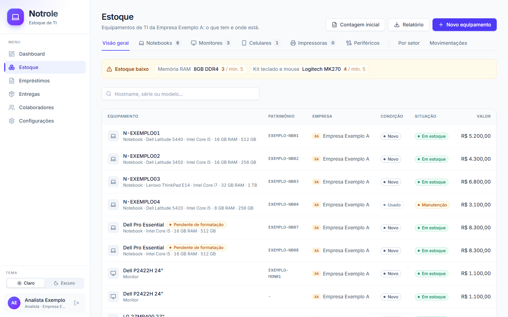
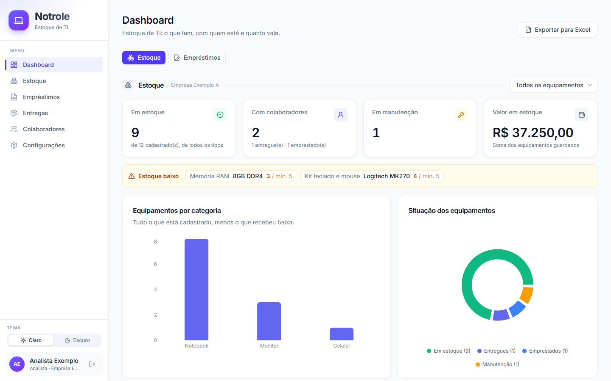
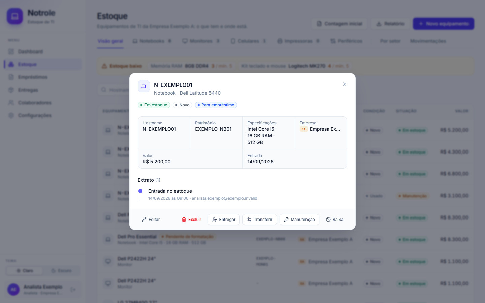
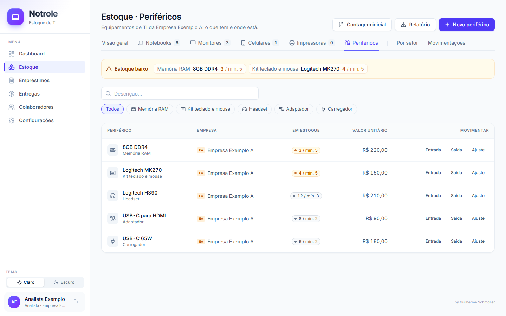
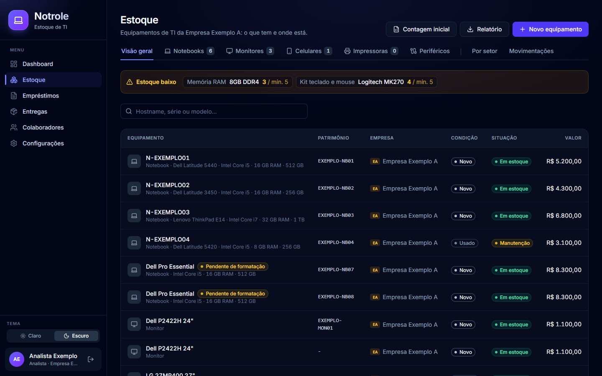
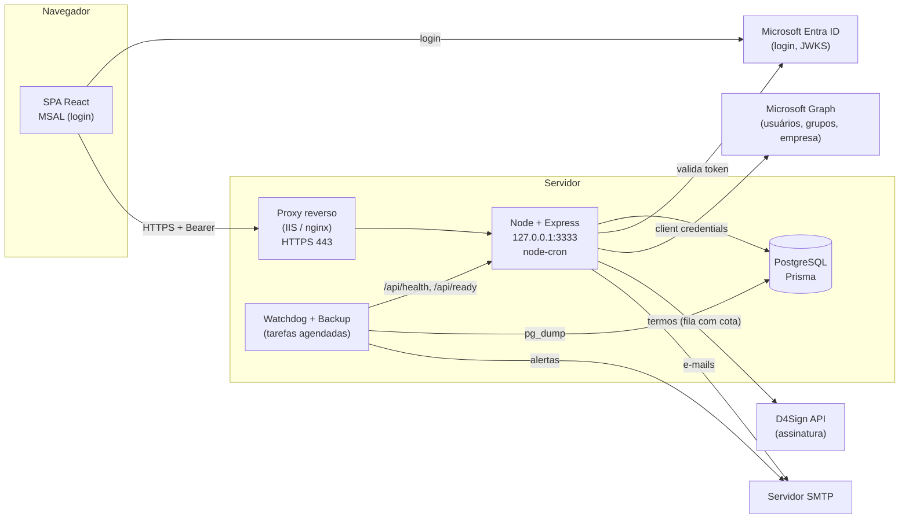

# Notrole

**Controle de estoque de TI, empréstimos e entregas de equipamentos, com termo de comodato assinado digitalmente.**

O Notrole responde, para a equipe de TI, três perguntas que costumam viver em planilhas (ou em lugar nenhum):
**o que existe em estoque**, **onde está cada equipamento** e **com quem**. Quando um equipamento sai para um
colaborador, o sistema gera o termo de comodato, envia para assinatura eletrônica no D4Sign, lembra o prazo,
cobra o atraso sozinho e emite o comprovante de devolução.

Foi construído para um ambiente corporativo real, com várias empresas sob a mesma TI, login único Microsoft
(Entra ID) e operação em Windows Server — e generalizado para servir a qualquer empresa.


---

## Sumário

- [O problema](#o-problema)
- [Telas](#telas)
- [Funcionalidades](#funcionalidades)
- [Stack](#stack)
- [Arquitetura](#arquitetura)
- [Estrutura de pastas](#estrutura-de-pastas)
- [Rodando localmente](#rodando-localmente)
- [Variáveis de ambiente](#variáveis-de-ambiente)
- [Empresas e administradores](#empresas-e-administradores)
- [Deploy](#deploy)
- [Segurança](#segurança)
- [Roadmap e limitações](#roadmap-e-limitações)
- [Documentação](#documentação)
- [Autor](#autor)
- [Licença](#licença)
- [English summary](#english-summary)

---

## O problema

Na TI de uma empresa média, notebooks, monitores, celulares e periféricos chegam em remessas, ficam numa
prateleira e saem conforme a necessidade. Sem um sistema:

- ninguém sabe, sem ir olhar, quantos notebooks novos existem nem quanto há parado em valor;
- o empréstimo é combinado de boca e a devolução depende de alguém lembrar;
- o termo de responsabilidade (quando existe) é impresso, assinado à mão e arquivado — ou se perde;
- quando há mais de uma empresa (CNPJ) sob a mesma TI, o termo sai em nome da empresa errada.

O Notrole resolve isso com um **estoque com extrato** (todo movimento registrado), **cessões com termo digital**
e **rotinas automáticas** de lembrete e cobrança.

## Telas

*Dados de demonstração (empresas, pessoas e números de série fictícios).*

**Estoque** — uma aba por tipo de equipamento, especificações na linha, aviso de estoque baixo e notebook
"pendente de formatação" quando ainda não tem hostname.



| Dashboard | Ficha do equipamento |
|---|---|
|  |  |
| **Periféricos por quantidade** | **Tema escuro** |
|  |  |

## Funcionalidades

**Estoque**
- **Estoque por tipo de equipamento**: uma aba por categoria principal (Notebooks, Monitores, Celulares,
  Impressoras...), configurável pelo administrador.
- **Computadores com hostname e especificações** (processador, memória e armazenamento); notebook ainda sem
  hostname aparece como **pendente de formatação**. Número de série obrigatório só onde faz sentido.
- **Periféricos por quantidade** (kit teclado e mouse, headset, adaptador): saldo, entrada, saída, ajuste e
  **estoque mínimo**.
- **Extrato de cada equipamento**: entrada, transferência entre empresas, manutenção, empréstimo, entrega,
  devolução e baixa — tudo numa `Movimentacao`, na mesma transação que muda a situação.
- Importação da contagem inicial por planilha; baixa (descarte/perda) com histórico preservado.

**Cessões**
- **Empréstimos com prazo**: lembrete na véspera e **cobrança automática de atraso** por e-mail (no máximo uma
  por dia, idempotente), renovação de prazo e devolução com a condição do equipamento.
- **Entregas definitivas** (equipamento de trabalho, sem prazo).
- **Comprovante de devolução em PDF**, anexado ao e-mail do colaborador.

**Termo de comodato com assinatura digital (D4Sign)**
- O Notrole **preenche o modelo Word** (`docs/modelos/*.docx`) com os dados da empresa, do colaborador e do
  equipamento e envia o documento pronto ao D4Sign. Um contrato com campo vazio **nunca** é gerado.
- **Fila com controle de cota**: respeita um teto de requisições por hora, mostra ao analista quando cada
  termo sai ("sai por volta das 14:20") e retoma de onde parou se uma etapa falhar.
- Detecção da assinatura por **consulta periódica** (funciona em rede interna, sem webhook) ou por webhook
  com segredo; a cessão vira ativa sozinha quando o colaborador assina.

**Multiempresa e permissões**
- Login único **Microsoft Entra ID**; acesso por **grupo de segurança** do AD.
- **Permissão por empresa**: cada analista vê e movimenta só a empresa do campo "Empresa" do seu perfil no
  AD; o **grupo de administradores** vê tudo, com filtro por empresa.
- A empresa comodante do termo é a do equipamento, imposta pelo servidor.

**Gestão**
- **Dashboard** de estoque e de empréstimos (valor parado, em uso, em manutenção, atrasos, vencimentos).
- **Relatórios em PDF e Excel**, sempre com os filtros da tela e a permissão do usuário.
- **Auditoria**: histórico de cada cessão (`HistoricoAcoes`), extrato do estoque, todos os e-mails enviados
  (com o erro, se houve) e quem alterou modelos e configurações.
- Modelos de e-mail editáveis na tela; tema claro/escuro.

**Operação (Windows Server)**
- API como **tarefa agendada** + **watchdog** a cada minuto: religa IIS e API, reinicia se travar, testa
  banco, HTTPS, backup e disco, e manda alertas por e-mail (PROBLEMA / CONTINUA / RESOLVIDO).
- **Backup diário** do PostgreSQL com retenção.
- **Deploy seguro** (build em pasta nova, typecheck antes de tocar no que está no ar) e **rollback** em
  segundos.

## Stack

| Camada | Tecnologia | Versão |
|---|---|---|
| Frontend | React | 19.2 |
| | Vite | 6.4 |
| | TypeScript | 5.8 |
| | Tailwind CSS | 4.2 |
| | MSAL (`@azure/msal-browser` / `@azure/msal-react`) | 5.21 / 5.7 |
| | Recharts · lucide-react · motion · sonner | 3.8 · 0.546 · 12 · 2.0 |
| Backend | Node.js | 20+ (produção em 24) |
| | Express | 4.22 |
| | Prisma (ORM e migrações) | 6.19 |
| | zod (validação) | 3.25 |
| | helmet · express-rate-limit · jwks-rsa · jsonwebtoken | 8 · 7 · 4 · 9 |
| | `@azure/msal-node` (Microsoft Graph) | 6.0 |
| | nodemailer · node-cron | 8.0 · 4.6 |
| | pdfkit · exceljs · jszip | 0.20 · 4.4 · 3.10 |
| | esbuild (bundle do backend) · tsx (dev) | 0.27 · 4.21 |
| Banco | PostgreSQL | 14+ (produção em 18) |
| Integrações | Microsoft Entra ID + Microsoft Graph, D4Sign API, SMTP | — |
| Operação | Windows Server + IIS (URL Rewrite + ARR), Agendador de Tarefas, PowerShell | — |

## Arquitetura

Uma aplicação só: o Express serve a API em `/api/*` e o build do React no resto. Em produção a API escuta
apenas em `127.0.0.1` e um proxy reverso (IIS, nginx...) termina o HTTPS.



Camadas do backend: **rota → controller** (valida com zod) **→ service** (regra de negócio) **→ repository**
(Prisma). Toda transição de estado é **condicional** (`updateMany` com o estado esperado; conflito vira 409),
e o banco tem a última trava: índice único parcial de cessão aberta por item e `CHECK (quantidade >= 0)`.
Detalhes e decisões em [docs/ARQUITETURA.md](docs/ARQUITETURA.md).

## Estrutura de pastas

```
.
├── src/
│   ├── api/                 backend (Express + Prisma)
│   │   ├── config/          env.ts (validação das variáveis) e cliente Prisma
│   │   ├── controllers/     entrada HTTP e validação com zod
│   │   ├── services/        regras de negócio (empréstimo, estoque, termo, D4Sign, e-mail, permissão...)
│   │   ├── repositories/    acesso ao banco
│   │   ├── middlewares/     autenticação (Entra ID), permissão por empresa, erros
│   │   ├── jobs/            rotinas: cobrança, lembrete, fila de termos
│   │   ├── routes/          todas as rotas da API
│   │   └── server.ts        ponto de entrada
│   └── web/                 frontend (React + Vite)
│       ├── pages/           Dashboard, Estoque, Empréstimos/Entregas, Colaboradores, Configurações
│       ├── components/      modais, painéis, layout e componentes de UI
│       ├── lib/             cliente HTTP, MSAL, rótulos de domínio, utilidades
│       └── types/           contrato da API
├── prisma/
│   ├── schema.prisma
│   ├── migrations/          só estrutura (+ categorias padrão do estoque)
│   └── seed.ts              empresas fictícias para demonstração
├── scripts/                 operação Windows (deploy, rollback, watchdog, backup, instalação) e utilitários
├── docs/                    arquitetura, configuração, operação, manual, modelos do termo, roadmap
└── public/                  ícones
```

## Rodando localmente

### Pré-requisitos

- **Node.js 20+** (testado em 24) e npm
- **PostgreSQL 14+**
- Um **registro de aplicativo no Microsoft Entra ID** (SPA com redirect `http://localhost:3000`, segredo de
  cliente e permissões de aplicativo `User.Read.All` e `GroupMember.Read.All` no Microsoft Graph) — passo a
  passo em [docs/CONFIGURACAO.md](docs/CONFIGURACAO.md)
- Um **servidor SMTP** (para os e-mails)
- Opcional: conta **D4Sign** com acesso à API (sem ela, as cessões nascem ativas, sem termo)

### Passo a passo

```bash
git clone https://github.com/geducorp/notrole.git
cd notrole
npm ci

cp .env.example .env          # preencha; em dev: NODE_ENV=development, CORS_ORIGINS=http://localhost:3000,
                              # JOBS_HABILITADOS=false, D4SIGN_ATIVO=false
npm run db:migrate            # aplica as migrações (prisma migrate deploy)
npm run db:generate           # gera o Prisma Client
npm run db:seed               # opcional: duas empresas fictícias
```

Em dois terminais:

```bash
npm run dev:api               # API em http://localhost:3333 (tsx watch)
npm run dev                   # frontend em http://localhost:3000 (proxy /api -> 3333)
```

### Scripts npm

| Comando | O que faz |
|---|---|
| `npm run dev` | Frontend (Vite) em modo de desenvolvimento |
| `npm run dev:api` | API com recarga automática (`tsx watch`) |
| `npm run typecheck` | Verifica tipos do frontend, do backend, do seed e do `vite.config.ts` |
| `npm run build` | Compila o frontend para `dist/` |
| `npm run build:api` | Compila o backend para `dist-server/server.mjs` (esbuild) |
| `npm run db:migrate` | Aplica as migrações pendentes |
| `npm run db:migrate:dev` | Cria uma migração nova (base de desenvolvimento) |
| `npm run db:seed` | Cadastra as empresas de exemplo (idempotente) |
| `npm run db:studio` | Abre o Prisma Studio |
| `npm run deploy` | Deploy no Windows (`scripts/deploy.ps1`) |

## Variáveis de ambiente

O modelo completo, comentado, está em [`.env.example`](.env.example). A API valida tudo na inicialização
(`src/api/config/env.ts`) e encerra dizendo o que falta.

| Variável | Obrigatória | Descrição |
|---|---|---|
| `NODE_ENV`, `PORT`, `HOST` | não | Ambiente, porta (3333) e endereço de escuta (`127.0.0.1`) |
| `APP_URL` | não | Endereço público (o watchdog testa `APP_URL/api/health` pelo proxy reverso) |
| `CORS_ORIGINS` | não | Origens do CORS (vazio em produção; `http://localhost:3000` em dev) |
| `DATABASE_URL` | **sim** | Conexão PostgreSQL |
| `AZURE_TENANT_ID`, `AZURE_CLIENT_ID` | **sim** | Registro do aplicativo no Entra ID |
| `AZURE_CLIENT_SECRET` | **sim** | Segredo para o Microsoft Graph (busca no AD, grupos, empresa) |
| `AZURE_GRUPO_AUTORIZADO_ID` | recomendada | Grupo que pode usar o sistema (vazio = todo o tenant) |
| `AZURE_GRUPO_ADMIN_ID` | recomendada | Grupo de administradores (vazio = todos são administradores) |
| `SMTP_HOST`, `SMTP_PORT`, `SMTP_USER`, `SMTP_PASS` | **sim** | Servidor de e-mail |
| `SMTP_FROM_NAME`, `SMTP_SECURE`, `SMTP_REJECT_UNAUTHORIZED` | não | Remetente, TLS implícito (465) e validação do certificado |
| `ALERTA_EMAIL` | não | Destinatários dos alertas de operação (watchdog, deploy, backup) |
| `D4SIGN_ATIVO` | não | Chave geral da integração (`false` = nenhuma chamada) |
| `D4SIGN_API_KEY`, `D4SIGN_CRYPT_KEY`, `D4SIGN_SAFE_ID` | se D4Sign | Credenciais e cofre dos termos |
| `D4SIGN_MODELO`, `D4SIGN_AMBIENTE` | não | Modelo `.docx` alternativo; `producao` ou `sandbox` |
| `D4SIGN_REQUISICOES_POR_HORA`, `D4SIGN_MAX_TENTATIVAS` | não | Cota da fila (padrão 6/h) e tentativas |
| `D4SIGN_CONSULTA_AUTOMATICA`, `D4SIGN_HORAS_ENTRE_CONSULTAS`, `D4SIGN_DIAS_MAX_CONSULTA` | não | Conferência periódica da assinatura |
| `D4SIGN_WEBHOOK_SECRET` | não | Liga o webhook `POST /api/webhooks/d4sign` |
| `CRON_TIMEZONE`, `CRON_COBRANCA`, `CRON_LEMBRETE`, `CRON_TERMOS`, `JOBS_HABILITADOS` | não | Agenda das rotinas |
| `VITE_AZURE_CLIENT_ID`, `VITE_AZURE_TENANT_ID` | **sim** (build) | Login no frontend |
| `VITE_AZURE_API_SCOPE`, `VITE_API_URL` | não | Scope da API (`api://.../access_as_user`) e URL da API |

> As `VITE_*` são lidas no **build**: mudou uma, rode `npm run build` de novo.

## Empresas e administradores

O Notrole é **multiempresa**: cada empresa (CNPJ) tem o seu estoque e é a comodante dos termos dos seus
equipamentos.

1. **Cadastre as empresas** em **Configurações → Empresas → Nova empresa**: nome curto, razão social, CNPJ,
   endereço (vão no termo), pasta no D4Sign e as **palavras do AD** (`termosAD`).
   As migrações não inserem empresas; para experimentar, `npm run db:seed` cria "Empresa Exemplo A" e "B".
2. **`termosAD`** são palavras separadas por vírgula que reconhecem a empresa no campo **"Empresa"**
   (`companyName`) do perfil do usuário no Entra ID, sem diferenciar maiúsculas e acentos. Ex.: `acme`
   reconhece "ACME Indústria Ltda" e "Acme - Filial Norte".
3. Marque uma empresa como **padrão**: ela é usada no termo quando o colaborador não tem empresa no AD
   (nunca na permissão do analista).
4. **Analistas**: membros de `AZURE_GRUPO_AUTORIZADO_ID`. Cada um vê e movimenta só a empresa do seu
   perfil no AD; sem empresa no AD, vê a tela "Empresa não identificada".
5. **Administradores**: membros de `AZURE_GRUPO_ADMIN_ID`. Veem todas as empresas, cadastram empresas,
   categorias e modelos de e-mail e controlam a integração com o D4Sign.

Na interface, cada empresa ganha um **selo com as iniciais** e uma cor estável derivada do nome. Para usar o
logo de verdade, coloque a imagem em `src/web/assets/empresas/` e registre em `LOGOS`
(`src/web/components/ui/Empresa.tsx`).

## Deploy

**Windows Server + IIS (instalação de referência).** Os scripts em `scripts/` montam tudo:

```powershell
.\scripts\configurar.ps1                      # preenche o .env interativamente
.\scripts\instalar-servico.ps1 -Dominio notrole.suaempresa.com.br   # IIS, tarefas, firewall, ACL do .env
.\scripts\backup-banco.ps1 -InstalarTarefa    # backup diário
.\scripts\proteger-banco.ps1                  # usuário próprio no PostgreSQL, banco só em localhost
.\scripts\deploy.ps1                          # build em pasta nova, migra, typecheck, troca e reinicia
.\scripts\voltar-versao.ps1                   # rollback para a versão anterior
```

O caminho `C:\Sistemas\Notrole` aparece nos scripts e na documentação apenas como **exemplo** de pasta de
instalação. Guia completo em [docs/OPERACAO.md](docs/OPERACAO.md).

**Qualquer host Node.** A aplicação é Node puro: `npm ci && npm run build && npm run build:api`, aplique as
migrações (`npm run db:migrate`) e rode `node dist-server/server.mjs` atrás de um proxy reverso com HTTPS
(nginx, Caddy, IIS...). Use um gerenciador de processo (systemd, por exemplo) com **uma instância só** — as
rotinas rodam dentro do processo e uma segunda instância duplicaria os e-mails.

## Segurança

- **Sem segredos no código**: tudo vem do `.env` (fora do git), validado com zod na inicialização.
- **Autenticação**: JWT do Entra ID validado por assinatura (JWKS), issuer, audience e algoritmo; o acesso
  exige o grupo do AD; falha do Graph **nega** (nunca vira porta aberta).
- **Autorização no servidor**: empresa conferida em toda rota de negócio (a tela só esconde).
- **HTTP**: helmet com CSP própria, CORS fechado em produção, rate limit, `trust proxy` para o proxy reverso,
  limite de corpo.
- **Rede**: API só em `127.0.0.1`; banco com usuário próprio (não superusuário) e só em localhost
  (`scripts/proteger-banco.ps1`).
- **Validação** com zod em toda entrada; erros do Prisma traduzidos sem vazar SQL; 500 sem detalhes em
  produção.
- **Webhook do D4Sign** com segredo comparado em tempo constante, e o status sempre reconsultado na API do
  D4Sign.
- **Trilha de auditoria** completa (histórico de cessões, extrato do estoque, e-mails enviados, quem alterou
  o quê).

Encontrou uma vulnerabilidade? Fale com o autor antes de abrir uma issue pública.

## Roadmap e limitações

Veja [docs/ROADMAP.md](docs/ROADMAP.md). Principais pontos:

- [ ] Testes automatizados (a maior lacuna) e CI
- [ ] Contador de cota do D4Sign persistido (hoje em memória)
- [ ] Botão "Assinar" direto no e-mail do Notrole
- [ ] Colunas próprias por tipo de equipamento; paginação; reserva antecipada

Limitações: login só por Microsoft Entra ID; interface só em português; operação automatizada pensada para
Windows Server (em Linux, use systemd/nginx/cron). Os modelos de termo são um ponto de partida — **revise com
o seu jurídico**.

## Documentação

| Documento | Conteúdo |
|---|---|
| [docs/ARQUITETURA.md](docs/ARQUITETURA.md) | Decisões de projeto e o porquê |
| [docs/DOCUMENTACAO_TECNICA.md](docs/DOCUMENTACAO_TECNICA.md) | Referência técnica completa (modelo de dados, API, rotinas, segurança) |
| [docs/CONFIGURACAO.md](docs/CONFIGURACAO.md) | Entra ID, D4Sign e SMTP passo a passo |
| [docs/OPERACAO.md](docs/OPERACAO.md) | Operação no Windows Server: watchdog, backup, deploy, incidentes |
| [docs/ESTOQUE.md](docs/ESTOQUE.md) | Concepção do controle de estoque |
| [docs/MANUAL_DO_USUARIO.md](docs/MANUAL_DO_USUARIO.md) | Manual do analista |
| [docs/modelos/README.md](docs/modelos/README.md) | Como o termo de comodato (.docx) é preenchido |
| [docs/ROADMAP.md](docs/ROADMAP.md) | Roadmap e limitações conhecidas |
| [CONTRIBUTING.md](CONTRIBUTING.md) | Regras da casa para quem mexe no código |

## Autor

**Guilherme Schmoller**

- GitHub: [github.com/geducorp](https://github.com/geducorp)
- LinkedIn: [linkedin.com/in/guilherme-schmoller-1907762b1](https://www.linkedin.com/in/guilherme-schmoller-1907762b1)

## Licença

Distribuído sob a licença MIT. Veja [LICENSE](LICENSE).

---

## English summary

**Notrole** is an IT asset management system for small and mid-sized companies: inventory, equipment loans and
permanent handovers to employees, with a **digital loan agreement (comodato) signed through D4Sign**.

- **Inventory** by equipment type (laptops, monitors, phones...) plus quantity-tracked peripherals with
  minimum stock, and a full movement ledger for every asset.
- **Loans** with due dates, automatic reminders and overdue notices by e-mail; **permanent handovers**; PDF
  return receipts.
- **Digital agreement**: the app fills a Word template and sends it to D4Sign through a rate-limited queue,
  then detects the signature automatically.
- **Multi-company**: each analyst sees only the company set in their Microsoft Entra ID profile; admins see
  everything.
- **Dashboard**, PDF/Excel reports and a complete audit trail.
- **Ops on Windows Server**: scheduled-task service, watchdog with e-mail alerts, daily PostgreSQL backups,
  safe deploys with one-command rollback.

Stack: React 19, Vite, TypeScript, Tailwind CSS 4, Express, Prisma, PostgreSQL, Microsoft Entra ID (MSAL).
The UI and docs are in Brazilian Portuguese. Licensed under MIT. Author: Guilherme Schmoller.
