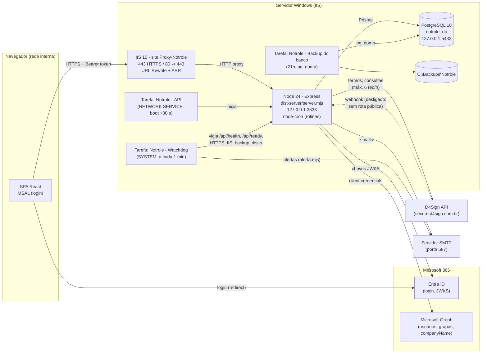
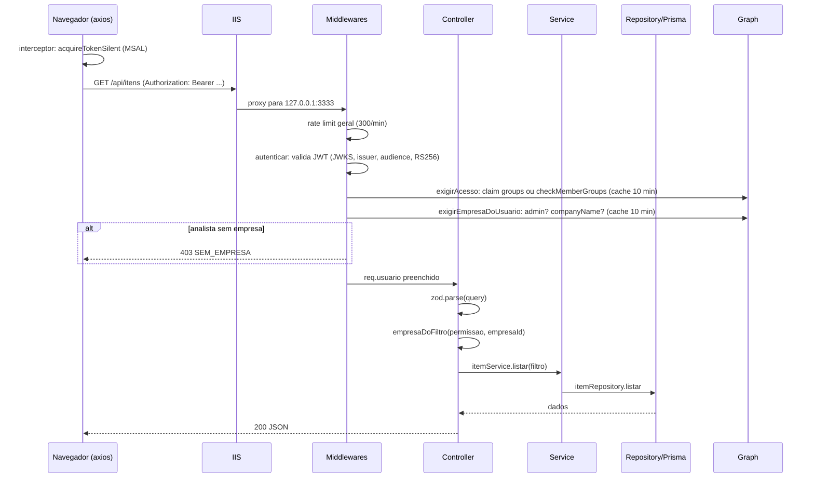
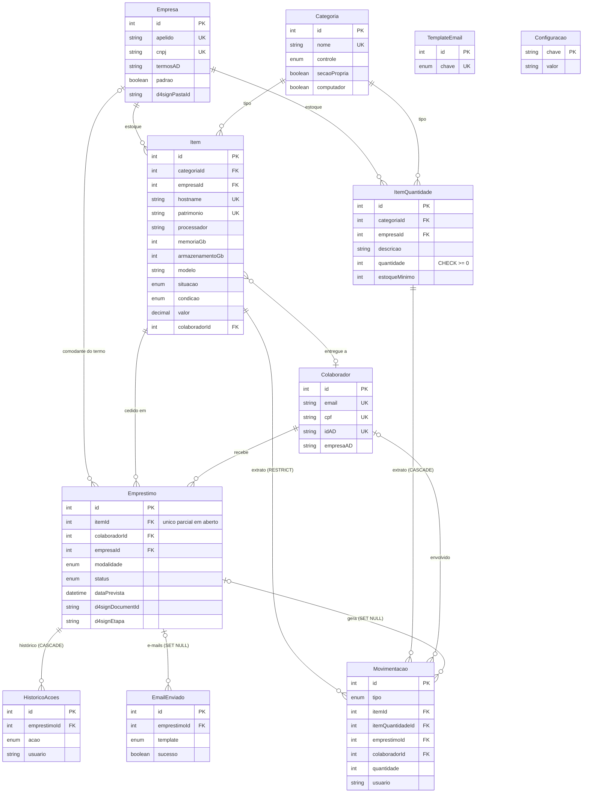
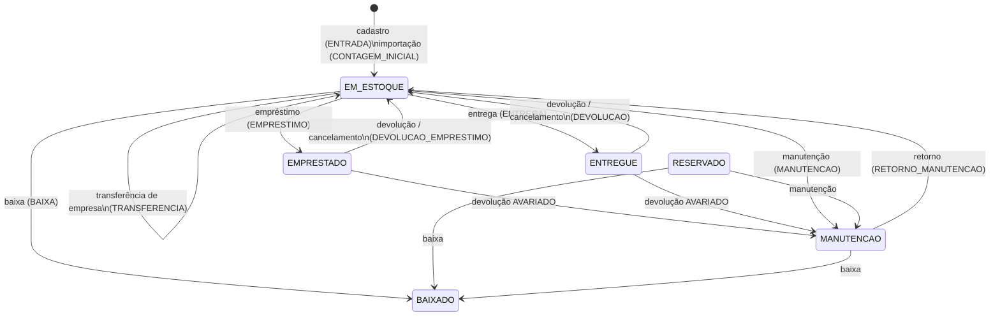
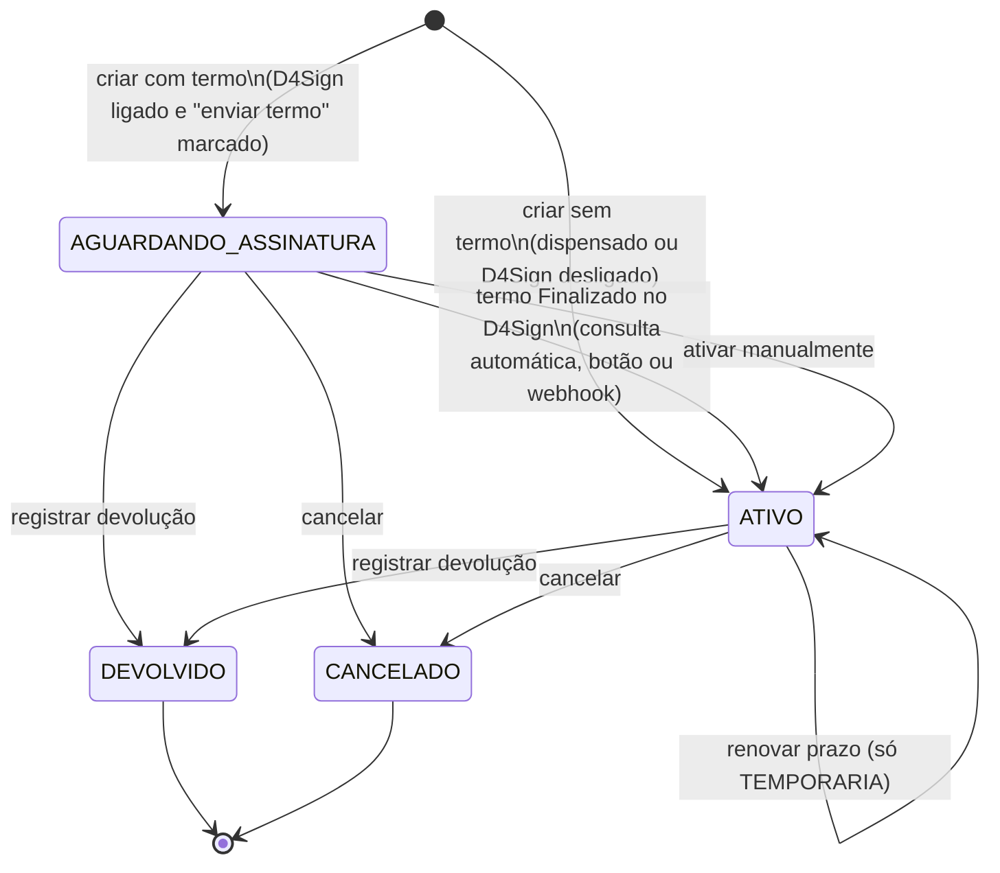
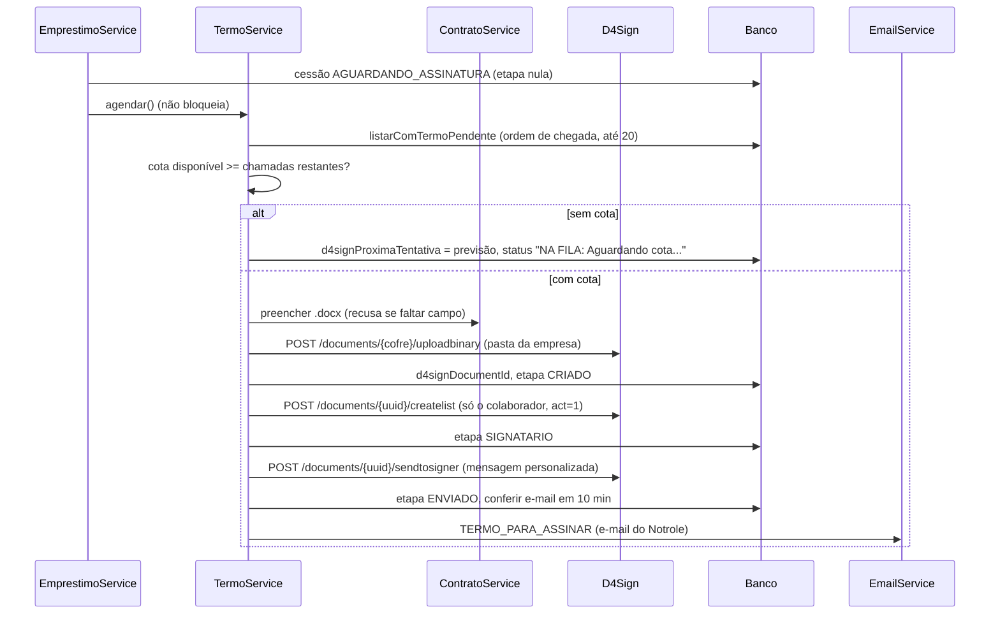

# Notrole - Documentação Técnica

*Controle de estoque de TI, empréstimos e entregas de equipamentos, multiempresa*

| | |
|---|---|
| **Versão do documento** | 10/2026 |
| **Instalação de exemplo** | Windows Server + IIS, pasta `C:\Sistemas\Notrole` (ajuste para a sua) |
| **Endereço de exemplo** | https://notrole.exemplo.com.br (rede interna) |
| **Público** | Desenvolvedor ou analista de infraestrutura que vai manter o sistema |

Documentos complementares na mesma pasta:

| Documento | Para quê |
|---|---|
| [`../CONTRIBUTING.md`](../CONTRIBUTING.md) | Regras da casa para quem mexe no código |
| [`ARQUITETURA.md`](ARQUITETURA.md) | O **porquê** das decisões de projeto |
| [`OPERACAO.md`](OPERACAO.md) | Guia do dia a dia no servidor |
| [`CONFIGURACAO.md`](CONFIGURACAO.md) | Passo a passo nos portais externos (Entra ID, D4Sign, SMTP) |
| [`ESTOQUE.md`](ESTOQUE.md) | Concepção do controle de estoque |
| [`ROADMAP.md`](ROADMAP.md) | Roadmap e limitações conhecidas |
| [`modelos/README.md`](modelos/README.md) | Como o termo de comodato (.docx) é preenchido |
| [`MANUAL_DO_USUARIO.md`](MANUAL_DO_USUARIO.md) | Manual do usuário final |

---

## Sumário

1. [Visão geral](#1-visão-geral)
2. [Tecnologias e versões](#2-tecnologias-e-versões)
3. [Arquitetura](#3-arquitetura)
4. [Estrutura de pastas](#4-estrutura-de-pastas)
5. [Modelo de dados](#5-modelo-de-dados)
6. [Regras de negócio](#6-regras-de-negócio)
7. [Autenticação e permissões](#7-autenticação-e-permissões)
8. [API](#8-api)
9. [Integrações](#9-integrações)
10. [Rotinas automáticas](#10-rotinas-automáticas)
11. [Relatórios e documentos](#11-relatórios-e-documentos)
12. [Frontend](#12-frontend)
13. [Configuração (variáveis de ambiente)](#13-configuração-variáveis-de-ambiente)
14. [Operação](#14-operação)
15. [Segurança](#15-segurança)
16. [Como desenvolver e manter](#16-como-desenvolver-e-manter)
17. [Roadmap](#17-roadmap)

---

## 1. Visão geral

### 1.1 O que é

O Notrole controla o **estoque de TI** de uma ou mais empresas e as
**cessões de equipamentos** aos colaboradores:

- cadastro de equipamentos (notebook, monitor, celular, impressora...) e de
  periféricos controlados por saldo (kit teclado e mouse, headset, adaptador...);
- extrato de tudo o que acontece com cada equipamento (entrada, transferência,
  manutenção, empréstimo, entrega, devolução, baixa);
- **empréstimo** (temporário, com prazo, lembrete e cobrança de atraso) e
  **entrega** (definitiva, sem prazo), as duas com **termo de comodato**
  assinado eletronicamente pelo colaborador no **D4Sign**;
- e-mails automáticos ao colaborador (termo para assinar, confirmação,
  lembrete, cobrança, comprovante de devolução em PDF);
- dashboard, relatórios em PDF e planilha Excel.

### 1.2 Para quem

| Perfil | Quem | O que faz |
|---|---|---|
| **Analista** | Membro do grupo de acesso do AD | Vê e movimenta só o estoque **da empresa dele** (campo "Empresa" do AD) |
| **Administrador** | Membro do grupo de administradores do AD | Vê e movimenta todas as empresas, cadastra categorias, cadastra e edita empresas e modelos de e-mail, pausa o D4Sign, roda rotinas na mão |
| **Colaborador** | Qualquer pessoa do AD | Não acessa o Notrole: recebe e-mails e assina o termo no D4Sign |

### 1.3 Escopo

**Dentro:** estoque de cada empresa (um estoque por empresa, sem "local"),
cessões com termo, notificações, relatórios, operação em Windows Server/IIS.

**Fora (de propósito):** paginação, múltiplas instâncias, inventário com QR
Code (etapa 3 do ESTOQUE.md, não iniciada), testes automatizados (lacuna
conhecida), acesso pela internet (pensado para rede interna).

### 1.4 Glossário

| Termo | Significado |
|---|---|
| **Item** | Equipamento identificado, um registro por equipamento físico, com extrato próprio e número de série (`patrimonio`; obrigatório só em computador). Modelo `Item` (antes `Notebook`). |
| **Periférico / item por quantidade** | Material controlado por saldo (`ItemQuantidade`): "tenho 14, restam 3". Na interface tudo o que não é equipamento principal aparece como "Periférico" (antes "Acessório"); no código os nomes `acessorios`/`ItemQuantidade` foram mantidos. |
| **Categoria** | Tipo de equipamento, cadastrado pela TI. `controle` = `ITEM` (por equipamento) ou `QUANTIDADE` (por saldo). `secaoPropria` = equipamento principal, com aba própria no Estoque. `computador` = notebook/desktop: exige número de série, tem hostname e especificações. |
| **Pendente de formatação** | Computador sem hostname (ainda não formatado e posto na rede). Derivado, sem coluna: `pendenteDeFormatacao` em `dominio.ts`. |
| **Cessão** | Registro em `Emprestimo`: um item cedido a um colaborador. Tem duas modalidades. |
| **Empréstimo** | Cessão `modalidade = TEMPORARIA`: tem `dataPrevista`, lembrete na véspera e cobrança de atraso. Item fica `EMPRESTADO`. |
| **Entrega** | Cessão `modalidade = DEFINITIVA`: sem prazo, o equipamento vira ferramenta de trabalho da pessoa até ser devolvido. Item fica `ENTREGUE` e `Item.colaboradorId` aponta para a pessoa. |
| **Termo de comodato** | Contrato .docx preenchido pelo Notrole (modelos em `docs/modelos`) e enviado ao D4Sign. Só o colaborador assina. |
| **Movimentação** | Linha do extrato (`Movimentacao`). Toda mudança de situação de item gera uma, na mesma transação. |
| **Baixa** | Item sai de circulação (descarte, perda, venda): situação `BAIXADO`, movimentação `BAIXA`, histórico preservado. |
| **Exclusão** | Apagar o item do banco. Só é permitida para item sem histórico (cadastro errado). |
| **Transferência** | Item muda de empresa (estoque de outra unidade), com movimentação `TRANSFERENCIA`. |
| **Empresa** | Cadastrada em Configurações > Empresas (`Empresa`). Dona do estoque e comodante no termo. Identificada pelo campo "Empresa" do AD via `termosAD`. |
| **Empresa padrão** | Empresa com `padrao = true`. Usada no termo quando o colaborador não tem empresa no AD. **Não** é usada para a permissão do analista. |
| **Atrasado** | Calculado, não gravado: empréstimo em aberto cujo prazo venceu (fim do dia). |
| **Fila de termos** | Cessões com termo pendente de geração no D4Sign, persistidas no próprio `Emprestimo` e processadas respeitando a cota. |

---

## 2. Tecnologias e versões

Versões de referência (`package.json`/`package-lock.json`; Node e PostgreSQL usados em produção).

| Camada | Tecnologia | Versão | Uso |
|---|---|---|---|
| Frontend | React | 19.2.4 | SPA |
| | Vite | 6.4.4 | Build e servidor de desenvolvimento |
| | TypeScript | 5.8.3 | Tipagem (front e back) |
| | Tailwind CSS (`@tailwindcss/vite`) | 4.2.1 | Estilos, tema claro/escuro |
| | `@azure/msal-browser` / `@azure/msal-react` | 5.21.0 / 5.7.0 | Login Microsoft (Entra ID) |
| | axios | 1.20.0 | Cliente HTTP com interceptores |
| | recharts | 3.8.0 | Gráficos do dashboard |
| | lucide-react | 0.546.0 | Ícones |
| | sonner | 2.0.7 | Notificações (toasts) |
| | motion | 12.35.2 | Animações |
| | `@fontsource-variable/inter` | 5.x | Fonte Inter |
| Backend | Node.js | **24.14.1** (mínimo `>=20`) | Runtime |
| | Express | 4.22.3 | HTTP, API e arquivos estáticos |
| | Prisma / `@prisma/client` | 6.19.3 | ORM e migrações |
| | zod | 3.25.76 | Validação de entrada e do `.env` |
| | jsonwebtoken + jwks-rsa | 9.0.3 / 4.x | Validação do token do Entra ID |
| | `@azure/msal-node` | 6.0.0 | Token de aplicativo para o Microsoft Graph |
| | helmet / cors / express-rate-limit | 8.3.0 / 2.x / 7.x | Segurança HTTP |
| | node-cron | 4.6.0 | Rotinas agendadas dentro do processo |
| | nodemailer | 8.0.11 | Envio de e-mail (SMTP) |
| | pdfkit | 0.20.2 | PDFs (relatórios e comprovante) |
| | exceljs | 4.4.0 | Planilha .xlsx |
| | jszip | 3.10.2 | Preenchimento do .docx do termo |
| | date-fns | 4.x | Datas no frontend |
| | esbuild | 0.27.7 | Compila o backend em `dist-server/server.mjs` |
| | tsx | 4.21.0 | Execução TypeScript em desenvolvimento |
| Banco | PostgreSQL | **18.6** | Base `notrole_db`, usuário `notrole_app`, só localhost |
| Integrações | Microsoft Entra ID / Microsoft Graph v1.0 | - | Login, grupos, busca no AD, empresa do usuário |
| | D4Sign API v1 | - | Assinatura eletrônica do termo |
| | SMTP (qualquer servidor, ex.: Exchange/Microsoft 365) | - | E-mails |
| Infra | Windows Server 2016+ | - | Sistema operacional (instalação de referência) |
| | IIS 10.0 + URL Rewrite + ARR | - | HTTPS e proxy reverso (site `Proxy-Notrole`) |
| | Agendador de Tarefas do Windows | - | `Notrole - API`, `Notrole - Watchdog`, `Notrole - Backup do banco` |

---

## 3. Arquitetura

### 3.1 Visão geral

Uma aplicação só: o Express serve a API em `/api/*` e o build do React em todo
o resto. Não há servidor de frontend separado nem CORS em produção. O IIS
termina o HTTPS e repassa para a API, que escuta **apenas em 127.0.0.1:3333**.



### 3.2 Camadas do backend

```
rota (routes/index.ts) -> middleware (protegido / negocio / somenteAdministrador)
  -> controller (valida com zod) -> service (regra, transações) -> repository (Prisma)
```

- **Controller:** valida `req.params`, `req.query` e `req.body` com zod, resolve
  a permissão (`permissaoService.doUsuario`) e chama o service. Não tem regra.
- **Service:** regra de negócio, transações (`prisma.$transaction`),
  chamadas de rede (sempre **fora** da transação).
- **Repository:** única camada que fala com o Prisma (exceção histórica:
  alguns services usam `prisma` direto dentro de transações).
- **Erros:** tudo cai no `errorHandler` central (ver 3.4).

### 3.3 Fluxo de uma requisição de negócio



### 3.4 Tratamento de erros (`middlewares/errorHandler.ts`)

Toda resposta de erro tem o formato `{ mensagem, codigo, ... }`.

| Origem | Status | `codigo` |
|---|---|---|
| `AppError` (regra de negócio) | o do erro | `NAO_ENCONTRADO`, `CONFLITO`, `NAO_AUTORIZADO`, `OUTRA_EMPRESA`, `SEM_EMPRESA`, `SO_ADMINISTRADOR`, `PERFIL_INDISPONIVEL`, `SEM_COTA`, `DADOS_DO_TERMO`, `SEM_VALOR`, `SEM_PATRIMONIO`, `CPF_DE_OUTRO_COLABORADOR`, `EMPRESA_NAO_CADASTRADA`, `SEM_TOKEN`, `TOKEN_INVALIDO`... |
| `ZodError` | 422 | `VALIDACAO` (+ `campos: [{campo, erro}]`) |
| Prisma P2002 (único) | 409 | `DUPLICADO` ("Já existe um registro com esse X") |
| Prisma P2025 | 404 | `NAO_ENCONTRADO` |
| Prisma P2003 (FK) | 409 | `EM_USO` |
| Corpo inválido / grande / codificação | 400 / 413 / 415 | `JSON_INVALIDO` / `CORPO_GRANDE_DEMAIS` / `CODIFICACAO` |
| Rota `/api/*` inexistente | 404 | `ROTA_INVALIDA` |
| Qualquer outro | 500 | `ERRO_INTERNO` + `referencia` (id que aparece no `api.log` como `[erro <id>]`) |

Em produção o 500 não devolve detalhe; procure a `referencia` no log.

### 3.5 Processo único

As rotinas usam `node-cron` dentro do processo da API e a fila do D4Sign, a
pausa do D4Sign e o limitador de cota ficam em memória. Por isso **só pode
existir uma instância**: a tarefa `Notrole - API` usa
`MultipleInstancesPolicy = IgnoreNew`. Nunca suba com PM2 ou `npm start` em
produção (duplicaria e-mails).

---

## 4. Estrutura de pastas

```
C:\Sistemas\Notrole
├── CONTRIBUTING.md            regras da casa para quem mexe no código
├── README.md
├── package.json               scripts npm e dependências
├── tsconfig.json              frontend (src/web), alias "@/"
├── tsconfig.server.json       backend (src/api)
├── tsconfig.node.json         vite.config.ts
├── vite.config.ts             build do front (dist/), chunks charts/msal/vendor, proxy /api em dev
├── index.html                 entrada do Vite
├── .env                       configuração e segredos (fora do git, ACL restrita) - NÃO versionar
├── .env.example               modelo com os nomes das variáveis
├── .env.backup-*              cópias antigas do .env (segredos: manter protegidas)
├── prisma/
│   ├── schema.prisma          modelo de dados
│   └── migrations/            15 migrações SQL (ver 5.4)
├── src/
│   ├── api/                   BACKEND
│   │   ├── server.ts          Express, helmet/CORS/rate limit, boot, desligamento ordenado
│   │   ├── config/
│   │   │   ├── env.ts         valida o .env com zod (derruba o processo se faltar algo)
│   │   │   └── prisma.ts      PrismaClient único
│   │   ├── routes/index.ts    TODAS as rotas, middlewares protegido/negocio/somenteAdministrador
│   │   ├── middlewares/
│   │   │   ├── auth.ts        autenticar (JWT) + exigirAcesso (grupo do AD) = protegido
│   │   │   ├── permissao.ts   somenteAdministrador, exigirEmpresaDoUsuario (SEM_EMPRESA)
│   │   │   └── errorHandler.ts tratamento central de erros, 404 de API
│   │   ├── controllers/       validação zod + permissão; um por área
│   │   │   ├── ItemController.ts, EstoqueController.ts, EmprestimoController.ts,
│   │   │   ├── ColaboradorController.ts, EmpresaController.ts, ReportController.ts,
│   │   │   └── ConfiguracaoController.ts, WebhookController.ts
│   │   ├── services/
│   │   │   ├── ItemService.ts          cadastro/edição/exclusão de equipamento
│   │   │   ├── EstoqueService.ts       transferência, manutenção, baixa, devolução sem termo, saldos, por setor, resumo
│   │   │   ├── EmprestimoService.ts    cessões: criar, ativar, renovar, devolver, cancelar
│   │   │   ├── AvisosDoEmprestimo.ts   e-mails ao colaborador ao longo da cessão
│   │   │   ├── TermoService.ts         fila de termos, geração no D4Sign, acompanhamento da assinatura
│   │   │   ├── D4SignService.ts        cliente HTTP do D4Sign + limitador de cota
│   │   │   ├── ContratoService.ts      preenche o .docx do termo (jszip)
│   │   │   ├── ComprovanteService.ts   PDF do comprovante de devolução
│   │   │   ├── EmailService.ts         envio SMTP com novas tentativas e registro em EmailEnviado
│   │   │   ├── TemplateService.ts      modelos de e-mail (padrões e renderização)
│   │   │   ├── PermissaoService.ts     admin/analista, empresa do usuário, caches
│   │   │   ├── MicrosoftGraphService.ts busca no AD e conferência de grupo
│   │   │   ├── EmpresaService.ts       empresas e identificação por termosAD
│   │   │   ├── ConfiguracaoService.ts  pausa do D4Sign (tabela Configuracao)
│   │   │   ├── ReportService.ts        dashboard e PDFs
│   │   │   ├── PlanilhaService.ts      planilha .xlsx
│   │   │   └── ImportacaoService.ts    contagem inicial por CSV
│   │   ├── repositories/      Item, Estoque, Emprestimo, Colaborador, Historico
│   │   ├── jobs/
│   │   │   ├── index.ts       registra as rotinas (cobranca-atraso, lembrete-vencimento, fila-termos)
│   │   │   ├── agendador.ts   node-cron com fuso, noOverlap e última execução
│   │   │   └── NotificacaoJob.ts cobrança e lembrete (idempotentes)
│   │   └── utils/
│   │       ├── datas.ts       prazos, atraso, datas de formulário, dia útil
│   │       ├── itens.ts       nomeDoItem / descricaoDoItem / especificacoesDoItem
│   │       ├── documentos.ts  CPF, moeda, data por extenso
│   │       ├── LimitadorDeTaxa.ts janela deslizante de 1 h (cota do D4Sign)
│   │       ├── cron.ts        calcula execução anterior/próxima para a tela
│   │       └── AppError.ts    erro de negócio com status e código
│   └── web/                   FRONTEND (alias "@/")
│       ├── main.tsx           MSAL, bootstrap do React
│       ├── App.tsx            telas por aba, Login, Acesso negado, Empresa não identificada
│       ├── index.css          Tailwind e tokens de tema
│       ├── pages/             Dashboard, Estoque, Loans (Empréstimos/Entregas), Collaborators, Settings, Login
│       ├── components/        modais e painéis (ver 12.3); layout/ e ui/
│       ├── lib/               api.ts, msal.ts, perfil.ts, dominio.ts, icones.tsx, utils.ts
│       ├── types/index.ts     tipos espelhando a API
│       └── assets/            imagens opcionais (logos de empresa, ver ui/Empresa.tsx)
├── scripts/
│   ├── deploy.ps1             publica nova versão (ver 14.4)
│   ├── voltar-versao.ps1      rollback para a versão compilada anterior
│   ├── instalar-servico.ps1   monta IIS, tarefas, firewall e ACLs (idempotente)
│   ├── backup-banco.ps1       pg_dump + cópia do .env, retenção 30 dias; -InstalarTarefa
│   ├── proteger-banco.ps1     cria notrole_app, fecha o PostgreSQL para a rede
│   ├── configurar.ps1         grava valores no .env sem mostrá-los
│   ├── conferir-config.ps1    mostra o que está preenchido no .env (sem valores)
│   ├── d4sign-explorar.mjs    lista cofres/pastas do D4Sign (só leitura)
│   ├── d4sign-teste-contrato.ts gera teste-contrato.docx; --enviar-rascunho
│   ├── verificar-entra.mjs    consultas ao Entra ID (ex.: --empresas)
│   ├── inspecionar-banco.mjs  inspeção do banco
│   └── servico/
│       ├── iniciar-api.ps1    ação da tarefa da API (node dist-server/server.mjs, log em api.log)
│       ├── watchdog.ps1       vigia e corrige (ver 14.3)
│       ├── comum.ps1          funções comuns: parar API, alertas com estado, e-mail
│       └── alerta.mjs         envia e-mail de alerta pelo SMTP do .env
├── docs/                      esta documentação, manuais, modelos do termo (docs/modelos/*.docx)
├── dist/ , dist-server/       builds em produção (gerados, fora do git)
├── dist.anterior/ , dist-server.anterior/  versão anterior, usada pelo rollback
├── logs/                      api.log, watchdog.log, backup.log, alertas/, manutencao.lock
├── public/                    estáticos do Vite; favicon.svg é o ícone da guia (index.html)
└── Certificados/, *.cer, csr-notrole.txt   certificado do site
```

---

## 5. Modelo de dados

Banco PostgreSQL, schema em `prisma/schema.prisma`. Todos os ids são `Int`
autoincremento (exceto `Configuracao.chave`). Datas `createdAt`/`updatedAt`
automáticas na maioria das tabelas.

### 5.1 Enums

| Enum | Valores | Observação |
|---|---|---|
| `TipoControle` | `ITEM`, `QUANTIDADE` | Por equipamento ou por saldo |
| `CondicaoItem` | `NOVO`, `USADO` | "Descartado" é situação (`BAIXADO`), não condição |
| `SituacaoItem` | `EM_ESTOQUE`, `RESERVADO`, `EMPRESTADO`, `ENTREGUE`, `MANUTENCAO`, `BAIXADO` | `RESERVADO` existe mas nenhuma tela o atribui |
| `TipoMovimentacao` | `ENTRADA`, `CONTAGEM_INICIAL`, `ENTREGA`, `DEVOLUCAO`, `EMPRESTIMO`, `DEVOLUCAO_EMPRESTIMO`, `TRANSFERENCIA`, `MANUTENCAO`, `RETORNO_MANUTENCAO`, `BAIXA`, `AJUSTE` | Extrato |
| `StatusEmprestimo` | `AGUARDANDO_ASSINATURA`, `ATIVO`, `DEVOLVIDO`, `CANCELADO` | "Atrasado" não é status |
| `ModalidadeCessao` | `TEMPORARIA` (empréstimo), `DEFINITIVA` (entrega) | |
| `TipoAcao` | `CRIADO`, `TERMO_GERADO`, `TERMO_ASSINADO`, `ATIVADO`, `RENOVADO`, `LEMBRETE_ENVIADO`, `COBRADO`, `DEVOLVIDO`, `CANCELADO` | Histórico da cessão |
| `TipoTemplate` | `CONFIRMACAO_EMPRESTIMO`, `CONFIRMACAO_ENTREGA`, `LEMBRETE_PREVIO`, `COBRANCA_ATRASO`, `DEVOLUCAO_CONFIRMADA`, `TERMO_PARA_ASSINAR` | Modelos de e-mail |

### 5.2 Modelos

#### `Categoria`
| Campo | Tipo | Notas |
|---|---|---|
| `nome` | String | **único** |
| `controle` | `TipoControle` | |
| `icone` | String? | nome do ícone lucide |
| `ordem` | Int (0) | ordenação |
| `ativo` | Boolean (true) | |
| `secaoPropria` | Boolean (false) | equipamento principal: aba própria no Estoque. Forçado a `false` quando `controle = QUANTIDADE` |
| `computador` | Boolean (false) | notebook/desktop: exige `patrimonio`, tem hostname e especificações. Forçado a `false` quando `controle = QUANTIDADE` |

Relações: `itens Item[]`, `itensQuantidade ItemQuantidade[]`. Iniciais:
Notebook, Monitor, Celular, Impressora (`ITEM`, `secaoPropria = true`; só
Notebook com `computador = true`);
Memória RAM, Kit teclado e mouse, Headset, Adaptador, Carregador (`QUANTIDADE`).

#### `Item` (equipamento identificado)
| Campo | Tipo | Notas |
|---|---|---|
| `categoriaId`, `empresaId` | Int | FK obrigatórias |
| `hostname` | String? | **único**, gravado em maiúsculas |
| `patrimonio` | String? | **único**, gravado em maiúsculas; número de série / Service Tag. Obrigatório só em categoria `computador` (cadastro, edição e importação); sem ele, não sai termo de comodato (`SEM_PATRIMONIO`) |
| `processador` | String? | especificação, só em computador |
| `memoriaGb`, `armazenamentoGb` | Int? | especificações em GB (1 TB = 1024), só em computador |
| `marca` | String? | obrigatório no cadastro pela API |
| `modelo` | String | |
| `condicao` | `CondicaoItem` (NOVO) | vira `USADO` na devolução |
| `situacao` | `SituacaoItem` (EM_ESTOQUE) | **só muda por movimentação** (não aceita no PUT) |
| `observacoes` | String? | |
| `valor` | Decimal(12,2)? | exigido no termo |
| `dataEntrada` | DateTime (now) | gravada ao meio-dia local (`diaDeFormulario`) |
| `paraEmprestimo` | Boolean (false) | marca de "notebook de empréstimo" |
| `colaboradorId`, `entregueEm` | Int?, DateTime? | preenchidos quando `ENTREGUE` |

Índices: `situacao`, `categoriaId`, `empresaId`. Relações: `categoria`,
`empresa`, `colaborador?`, `emprestimos[]`, `movimentacoes[]`.

#### `ItemQuantidade` (periférico por saldo)
| Campo | Tipo | Notas |
|---|---|---|
| `categoriaId`, `empresaId` | Int | |
| `descricao` | String | |
| `quantidade` | Int (0) | **CHECK `quantidade >= 0`** no banco (migração `20261009180000`) |
| `estoqueMinimo` | Int? | abaixo disso, aviso de "comprar" |
| `valorUnitario` | Decimal(12,2)? | |
| `observacoes` | String? | |

Único composto `(empresaId, categoriaId, descricao)`.

#### `Movimentacao` (extrato)
| Campo | Tipo | Notas |
|---|---|---|
| `tipo` | `TipoMovimentacao` | |
| `data` | DateTime (now) | indexado |
| `itemId` | Int? | FK **`ON DELETE RESTRICT`**: excluir item não apaga extrato |
| `itemQuantidadeId` | Int? | FK `ON DELETE CASCADE` |
| `quantidade` | Int (1) | 1 para item; saldo movimentado para periférico |
| `empresaOrigemId`, `empresaDestinoId` | Int? | sem FK declarada |
| `colaboradorId` | Int? | FK |
| `emprestimoId` | Int? | FK `ON DELETE SET NULL` |
| `usuario` | String? | e-mail do analista ou `SISTEMA` |
| `observacao` | String? | |

#### `Colaborador`
| Campo | Tipo | Notas |
|---|---|---|
| `nome` | String | indexado |
| `email` | String | **único** |
| `cpf` | String? | **único**, formatado `000.000.000-00` |
| `departamento`, `cargo` | String? | do AD |
| `idAD` | String? | **único**; Object ID no Entra ID. É a chave principal de reconhecimento (o e-mail muda quando o domínio muda) |
| `endereco` | String? | exigido no termo |
| `empresaAD` | String? | campo "Empresa" do AD como veio |
| `ativo` | Boolean (true) | |

Colaborador **não tem empresa** no Notrole; a visibilidade para o analista é
derivada das cessões/itens/periféricos (ver 7.5).

#### `Empresa`
| Campo | Tipo | Notas |
|---|---|---|
| `apelido` | String | **único** ("Empresa Exemplo A") |
| `razaoSocial`, `logradouro`, `cidade`, `uf`, `cep` | String | vão no termo |
| `cnpj` | String | **único** |
| `d4signPastaId` | String? | pasta da empresa no cofre do D4Sign |
| `termosAD` | String | palavras-chave separadas por vírgula, comparadas sem maiúsculas/acentos contra o "Empresa" do AD |
| `padrao` | Boolean | só uma pode ser `true` (garantido no service) |
| `ativo` | Boolean | |

#### `Emprestimo` (cessão)
| Grupo | Campos |
|---|---|
| Identificação | `itemId`, `colaboradorId`, `modalidade` (TEMPORARIA), `empresaId?` (comodante do termo) |
| Datas | `dataInicio` (now), `dataPrevista?` (nulo na entrega; fim do dia), `dataDevolucao?` |
| Estado | `status` (AGUARDANDO_ASSINATURA), `renovacoes` (0) |
| Termo | `motivo?`, `acessorios?` (item 2 do contrato), `testemunhaNome?`, `testemunhaEmail?` (analista que registrou; hoje sai como "Registrado no Notrole por", sem assinar) |
| Fila D4Sign | `d4signDocumentId?`, `d4signStatus?`, `d4signEtapa?` (`CRIADO` / `SIGNATARIO` / `ENVIADO`), `d4signTentativas` (0), `d4signProximaTentativa?` |
| Assinatura | `d4signAssinadoEm?`, `d4signVerificadoEm?`, `d4signAssinados?`, `d4signSignatarios?` |
| Convite | `d4signAvisoEmail?`, `d4signEmailConferido` (false), `d4signConferirEmailEm?` |
| Notificações | `lembretePrevioEm?`, `ultimaCobrancaEm?` |
| Devolução | `condicaoDevolucao?` (BOM, AVARIADO...), `observacoesDevolucao?` (vai ao colaborador), `devolucaoRecebidaPorNome?`, `devolucaoRecebidaPorEmail?` |
| Outros | `observacoes?` (interna), `criadoPor?` |

Índices: `status`, `dataPrevista`, `itemId`, `colaboradorId`,
`d4signProximaTentativa`. **Índice único parcial** (fora do schema.prisma):

```sql
CREATE UNIQUE INDEX "Emprestimo_itemId_em_aberto_key"
  ON "Emprestimo"("itemId") WHERE "status" IN ('AGUARDANDO_ASSINATURA', 'ATIVO');
```

Garante no máximo **uma cessão em aberto por item**. O Prisma não representa
índice parcial: se `prisma migrate dev` propuser `DROP` dele, remova a linha.

#### `HistoricoAcoes`
`emprestimoId` (FK `CASCADE`), `acao TipoAcao`, `detalhes?`, `usuario?`
(e-mail ou `SISTEMA`/`D4SIGN`/`CONSULTA AUTOMATICA`/`CONSULTA MANUAL`),
`dataAcao`. Índices em `emprestimoId` e `dataAcao`.

#### `EmailEnviado`
`destinatario`, `assunto`, `template TipoTemplate`, `sucesso`, `erro?`,
`enviadoEm`, `emprestimoId?` (FK `SET NULL`). Cresce indefinidamente (ver ROADMAP.md).

#### `TemplateEmail`
`chave TipoTemplate` (**único**), `assunto`, `corpo`, `ativo`, `updatedBy?`.
`updatedBy` nulo = nunca editado (acompanha o texto padrão do código).

#### `Configuracao`
`chave` (PK texto), `valor`, `updatedBy?`. Hoje só `d4sign.pausado`.

### 5.3 Diagrama ER



### 5.4 Migrações

Aplicadas por `npx prisma migrate deploy` (no deploy). Pasta `prisma/migrations`.

| Migração | O que faz |
|---|---|
| `20260901124033_init` | Schema original: `Admin`, `Notebook`, `Colaborador`, `Emprestimo`, enums `StatusNotebook` e `StatusEmprestimo` |
| `20260918120000_estrutura_completa` | Refatoração: `HistoricoAcoes`, `EmailEnviado`, `TemplateEmail`, enums `TipoAcao`/`TipoTemplate`, campos que o código usava e não existiam (patrimônio, marca...) |
| `20260921180000_verificacao_assinatura` | `d4signVerificadoEm`, `d4signEtapa` (retomada por etapa, consulta econômica) |
| `20260922090000_termo_comodato` | Tabela `Empresa` (sem dados: empresas são cadastradas na tela ou pelo seed), `valor` do equipamento, `endereco`/`empresaAD` do colaborador, dados do termo no empréstimo |
| `20260922100000_comprovante_devolucao` | Quem recebeu a devolução, `observacoesDevolucao`, textos de e-mail com acento |
| `20260922120000_aviso_email_d4sign` | Conferência do envio do convite (`d4signAvisoEmail`, `d4signEmailConferido`, `d4signConferirEmailEm`) |
| `20260922130000_email_segundo_termo` | Texto da confirmação avisando do e-mail do D4Sign |
| `20260922150000_progresso_assinatura` | `d4signAssinados`, `d4signSignatarios` |
| `20260922160000_estoque` | `Notebook` vira `Item`; `Categoria`, `ItemQuantidade`, `Movimentacao`, enums de estoque; notebooks viram itens sem perder histórico |
| `20260923090000_entrega_com_comodato` | `ModalidadeCessao`, `dataPrevista` opcional, template `CONFIRMACAO_ENTREGA`, remove `fornecedor`/`notaFiscal` |
| `20260923120000_remove_local` | Remove o "local de estoque" (cada empresa tem um estoque só) |
| `20260923140000_configuracao` | Tabela `Configuracao` (pausa do D4Sign) |
| `20261009180000_integridade_estoque` | FK `Movimentacao -> Item` vira `RESTRICT`; índice único parcial de cessão aberta; `CHECK quantidade >= 0` |
| `20261013100000_template_termo_para_assinar` | Valor `TERMO_PARA_ASSINAR` no enum `TipoTemplate` |
| `20261013140000_categoria_secao_propria` | `Categoria.secaoPropria`; marca Notebook, Monitor, Celular e Impressora |
| `20261014180000_computador_e_especificacoes` | `Categoria.computador` (marca as categorias `ITEM` com "notebook" no nome); `Item.processador`, `memoriaGb`, `armazenamentoGb`; patrimônios existentes passam para maiúsculas |

---

## 6. Regras de negócio

### 6.1 Situações do item e transições

Toda mudança de situação acontece **dentro de uma transação** junto com a
`Movimentacao` correspondente, via `updateMany` **condicional** (situação
esperada no `where`). `count = 0` vira **409** "alterado por outra pessoa".



| Ação | Onde | Situações de origem aceitas | Resultado |
|---|---|---|---|
| Cadastrar | `ItemService.criar` | - | `EM_ESTOQUE` + `ENTRADA` (categoria precisa ser `ITEM`) |
| Emprestar | `EmprestimoService.criar` (TEMPORARIA) | `EM_ESTOQUE` | `EMPRESTADO` + `EMPRESTIMO` |
| Entregar | `EmprestimoService.criar` (DEFINITIVA) | `EM_ESTOQUE` | `ENTREGUE`, `colaboradorId`, `entregueEm` + `ENTREGA` |
| Devolver cessão | `EmprestimoService.registrarDevolucao` | `EMPRESTADO`/`ENTREGUE` (o que a cessão deixou) | `EM_ESTOQUE` (ou `MANUTENCAO` se AVARIADO), `condicao = USADO` + `DEVOLUCAO_EMPRESTIMO`/`DEVOLUCAO` |
| Cancelar cessão | `EmprestimoService.cancelar` | idem | `EM_ESTOQUE` + `DEVOLUCAO*` com observação "cancelado" |
| Receber de volta (sem termo) | `EstoqueService.receberDeVolta` | `ENTREGUE` **sem cessão aberta** | `EM_ESTOQUE`/`MANUTENCAO` + `DEVOLUCAO`. Recusa se houver cessão aberta (devolve-se pela cessão) |
| Transferir | `EstoqueService.transferir` | `EM_ESTOQUE`, `RESERVADO`, `MANUTENCAO`, `BAIXADO` (empresa de origem também no `where`) | `empresaId` muda + `TRANSFERENCIA` (origem/destino). O histórico de cessões acompanha o item |
| Manutenção | `EstoqueService.enviarParaManutencao` | `EM_ESTOQUE`, `RESERVADO`, `BAIXADO` | `MANUTENCAO` + `MANUTENCAO` |
| Retorno de manutenção | `EstoqueService.retornarDaManutencao` | `MANUTENCAO` | `EM_ESTOQUE` + `RETORNO_MANUTENCAO` |
| Baixa | `EstoqueService.darBaixa` | `EM_ESTOQUE`, `RESERVADO`, `MANUTENCAO` (motivo obrigatório) | `BAIXADO` + `BAIXA` |
| Editar | `ItemService.atualizar` | qualquer | Não muda `situacao` nem `empresaId` (empresa só por transferência). Troca de categoria só para outra `ITEM` |

> Observação: `SITUACOES_LIVRES` inclui `BAIXADO`, então hoje a API aceita
> transferir ou mandar para manutenção um item baixado. Nenhuma tela oferece
> isso para item baixado, mas vale saber.

### 6.2 Status da cessão (empréstimo/entrega)



- "Em aberto" = `STATUS_EM_ABERTO = ['AGUARDANDO_ASSINATURA', 'ATIVO']`.
- Todas as transições usam `mudarEmprestimoSeEstiver` (`updateMany` com
  `status in [...]`); duplo clique ou duas pessoas = **409**, sem movimentação,
  histórico nem e-mail duplicados.
- **Renovar:** só `TEMPORARIA` em aberto; nova data posterior ao prazo atual; o
  prazo lido também vai no `where`; zera `lembretePrevioEm` e `ultimaCobrancaEm`;
  incrementa `renovacoes`.
- **Devolver:** grava condição, observação para o colaborador, quem recebeu;
  libera o item (ver 6.1); envia `DEVOLUCAO_CONFIRMADA` com o comprovante PDF.
- **Cancelar:** libera o item, registra histórico e, **fora da transação**,
  cancela o documento no D4Sign. Se não conseguir (já assinado, sem cota,
  pausado, erro), registra no histórico e devolve o campo **`aviso`** na
  resposta; a tela mostra um aviso amarelo. Um termo já assinado continua
  válido no D4Sign.
- **Ativar manualmente:** só `AGUARDANDO_ASSINATURA`; envia a confirmação.
- **Termo cancelado direto no D4Sign:** `d4signStatus = 'CANCELADO NO D4SIGN'`,
  a cessão continua aberta esperando decisão do operador.

### 6.3 Criação de uma cessão (`EmprestimoService.criar`)

1. Empréstimo exige `dataPrevistaDevolucao` não passada (`dataDeFormulario` = fim
   do dia); entrega não tem prazo.
2. `comTermo = d4signHabilitado && enviarTermo !== false`. Com termo, valida
   CPF (dígito verificador), endereço (>= 10 caracteres), motivo (só no
   empréstimo) e analista identificado. Falta algo: 422 `DADOS_DO_TERMO`.
3. CPF já usado por outra pessoa (reconhecida por `idAD` ou e-mail): 409
   `CPF_DE_OUTRO_COLABORADOR`.
4. Permissão: analista só cede item da própria empresa e, **para ele, a empresa
   do termo é sempre a do equipamento** (o `empresaId` do formulário é
   ignorado). O admin escolhe; sem escolha, vale a empresa do AD do
   colaborador ou a padrão.
5. Grava/atualiza o colaborador (`criarOuAtualizarPorEmail`: procura primeiro
   pelo `idAD`, depois pelo e-mail; atualiza e-mail quando o domínio mudou).
6. Transação: confere empresa de novo, exige `valor` e `patrimonio` se houver
   termo (`SEM_VALOR`/`SEM_PATRIMONIO`), reserva o item com `updateMany`
   `situacao = EM_ESTOQUE`, cria a cessão, histórico `CRIADO` e movimentação.
   Se o D4Sign está ligado mas o termo foi dispensado: `d4signStatus = 'DISPENSADO'`.
7. Fora da transação: sem termo, envia a confirmação na hora; com termo, chama
   `termoService.agendar()` (a fila).

### 6.4 Saldo de periféricos (`ItemQuantidade`)

- **Entrada:** `quantidade > 0`, incrementa e registra `ENTRADA` (ou o tipo informado).
- **Saída:** `updateMany where quantidade >= n` + `decrement` (duas saídas
  simultâneas não deixam negativo) + `ENTREGA` (com `colaboradorId` opcional).
- **Ajuste:** novo saldo `>= 0`, diferente do atual, motivo obrigatório;
  condicional ao saldo lido + `AJUSTE`.
- **Exclusão:** só com saldo zero **e** sem movimentação além do cadastro.
- Última trava: `CHECK (quantidade >= 0)` no banco.

### 6.5 Datas e prazos (`src/api/utils/datas.ts`)

| Função | Regra |
|---|---|
| `fimDoDia` / `inicioDoDia` | 23:59:59.999 / 00:00 locais |
| `estaAtrasado(prazo)` | `agora > fimDoDia(prazo)`: o prazo vence no **fim** do dia |
| `diasDeAtraso(prazo)` | diferença em dias entre os inícios de dia (mínimo 1 se atrasado) |
| `mesmoDia(a, b)` | evita reenvio de e-mail no mesmo dia |
| `dataDeFormulario('aaaa-mm-dd')` | prazo: fim daquele dia local |
| `diaDeFormulario('aaaa-mm-dd')` | data que não é prazo (entrada): **meio-dia** local, para não "voltar um dia" por causa do UTC |
| `proximoDiaUtil` | seg-sex, sem feriados |
| `formatarData` | `pt-BR`, fuso `America/Sao_Paulo` |

Nunca compare `dataPrevista` com `new Date()` direto; nunca faça
`new Date('2026-10-09')` (é meia-noite UTC = dia anterior em Brasília).

### 6.6 Atraso calculado

A API devolve em cada cessão `atrasado` e `diasAtraso`, calculados em
`EmprestimoService.decorar`: em aberto, com prazo e `estaAtrasado`. Entrega
nunca atrasa. Não existe coluna de atraso, e não deve existir.

### 6.7 Baixa x exclusão

| | Baixa | Exclusão |
|---|---|---|
| Quando | Descarte, perda, venda | Cadastro feito por engano |
| Efeito | `situacao = BAIXADO`, movimentação `BAIXA` | Registro apagado |
| Condições | Item livre (não emprestado/entregue), motivo | Sem cessões, não `ENTREGUE`, e **só** movimentações `ENTRADA`/`CONTAGEM_INICIAL` (apagadas junto, na transação) |
| Histórico | Preservado | Não há histórico a perder |

Item baixado não aparece nas listas do Estoque; há o link discreto "Ver
equipamentos baixados (N)" na Visão geral.

### 6.8 Transferência

Muda `Item.empresaId` com a empresa de origem no `where`, registra
`TRANSFERENCIA` com origem e destino. Quem registra é quem envia (precisa ter
permissão na empresa de origem). O histórico de cessões do item acompanha o item
(decisão do usuário, 13/10/2026).

### 6.9 Concorrência e transações (resumo)

- Reserva do item, transições de item e de cessão, renovação, saldo:
  `updateMany` condicional + 409.
- Banco: índice único parcial de cessão aberta, `CHECK` de saldo, FK `RESTRICT`.
- Chamadas de rede (e-mail, D4Sign) sempre **depois** do commit.
- Rotinas: trava em memória por rotina e "reivindicação" no banco (ver 10).
- Fila de termos: flag `processando` impede cron e botão simultâneos.

---

## 7. Autenticação e permissões

### 7.1 Login (frontend)

- MSAL (`src/web/lib/msal.ts`), `PublicClientApplication`, autoridade
  `login.microsoftonline.com/<VITE_AZURE_TENANT_ID>`, `redirectUri =
  window.location.origin`, cache em `sessionStorage`.
- Escopo: `VITE_AZURE_API_SCOPE` (`api://<client-id>/access_as_user`) se
  existir; senão `User.Read` e o **id token** vai para a API (situação atual,
  ver 17).
- O interceptor do axios obtém o token com `acquireTokenSilent` antes de cada
  requisição e renova quando está para vencer.

### 7.2 Validação no backend (`middlewares/auth.ts`)

1. **`autenticar`**: `Authorization: Bearer`; `jwt.verify` com chave do JWKS do
   tenant (cache 12 h), `RS256`, issuers v1 (`sts.windows.net/<tenant>/`) e v2
   (`login.microsoftonline.com/<tenant>/v2.0`), audiences `AZURE_CLIENT_ID` e
   `api://AZURE_CLIENT_ID`. Preenche `req.usuario = { id (oid), email
   (preferred_username/upn/email), nome, grupos }`. O token nunca vai para o log.
2. **`exigirAcesso`**: se `AZURE_GRUPO_AUTORIZADO_ID` estiver vazio, todos do
   tenant entram (aviso no log). Senão: claim `groups` ou
   `checkMemberGroups` no Graph, com **cache de 10 min** por usuário. Falha do
   Graph nega a requisição **sem** gravar cache. Fora do grupo: 403
   `NAO_AUTORIZADO` (a tela mostra "Acesso negado").
3. `protegido` = `autenticar` + `exigirAcesso`.
4. **`negocio`** = `protegido` + `exigirEmpresaDoUsuario` (403 `SEM_EMPRESA`).
   Todas as rotas de negócio usam `negocio`; só `GET /me` usa `protegido` puro.
5. **`somenteAdministrador(acao)`**: 403 `SO_ADMINISTRADOR` para não-admin.

### 7.3 Grupos do AD

| Variável | Papel | Vazio |
|---|---|---|
| `AZURE_GRUPO_AUTORIZADO_ID` | Quem pode entrar no Notrole (ex.: "Notrole - Operadores") | Todo o tenant entra |
| `AZURE_GRUPO_ADMIN_ID` | Administradores | **Todos são administradores** (veem todas as empresas) |

### 7.4 Perfil e empresa (`services/PermissaoService.ts`)

`doUsuario(req.usuario)` devolve `{ email, admin, empresaId }`:

- **admin:** grupo admin na claim ou via Graph `checkMemberGroups`.
- **empresaId:** `GET graph/v1.0/users/<email>?$select=companyName` e
  `empresaService.identificarSemPadrao(companyName)`: compara cada termo de
  `Empresa.termosAD` (sem maiúsculas/acentos) como substring do texto do AD.
  **Não** cai na empresa padrão: texto que não bate = sem empresa.
- **Cache:** 10 min por e-mail (`cache`), mais o **último perfil bom**
  (`ultimoBom`, sem validade) e um cache por requisição (`WeakMap`).
- **Falha do Graph:** o resultado não vai para o cache; usa o último perfil bom;
  sem nenhum e com resultado "sem empresa", responde **503
  `PERFIL_INDISPONIVEL`** (a tela não vira "Empresa não identificada" por uma
  oscilação).
- **Limpeza do cache:** salvar uma empresa em Configurações > Empresas
  (`permissaoService.esquecer()`) ou reiniciar a API.

| Função | Uso |
|---|---|
| `semEmpresa(p)` | `!admin && empresaId === null` |
| `exigirEmpresaDefinida(p)` | 403 `SEM_EMPRESA` |
| `empresaVisivel(p)` | admin: `undefined` (todas); analista: a dele |
| `empresaDoFiltro(p, pedida)` | listas: admin usa a pedida; analista **sempre** a dele (ignora a query) |
| `exigirVisivel(p, empresaId)` | detalhes: 403 `OUTRA_EMPRESA` |
| `exigirEmpresa(p, empresaId, acao)` | ações: 403 `OUTRA_EMPRESA` |
| `exigirAdministrador(p, acao)` | 403 `SO_ADMINISTRADOR` (se o grupo admin existir) |

### 7.5 Regra por empresa

- **Listas e somas** (itens, periféricos, extrato, cessões, colaboradores,
  resumo, por setor, dashboard, Excel, PDFs, e-mails enviados, contagens da
  fila de termos): filtradas pela empresa do analista no servidor.
- **Detalhes** (ficha do item, cessão, histórico, comprovante, colaborador):
  `exigirVisivel`.
- **Ações** (cadastrar, editar, excluir, transferir, manutenção, baixa,
  devolução, ceder, renovar, cancelar, ativar, termo, importação, saldos):
  `exigirEmpresa` com a empresa do equipamento.
- **Colaborador** não tem empresa: o analista vê quem foi atendido pela empresa
  dele (cessão, equipamento entregue ou periférico de lá) e, de cada um, só as
  cessões da empresa dele. `GET /colaboradores/cadastro` acha qualquer pessoa
  por busca **exata** (idAD/e-mail), para o formulário de cessão.
- **Termo:** para o analista, empresa do termo = empresa do equipamento.
- **Sem usuário** (rotinas, fila de termos, webhook): não passam por essa regra.

### 7.6 Quem pode o quê

| Ação | Analista (com empresa) | Analista sem empresa | Administrador |
|---|---|---|---|
| Entrar / `GET /me` | Sim | Sim (`semEmpresa: true`) | Sim |
| Ver estoque, cessões, colaboradores, dashboard, relatórios | Só a empresa dele | 403 `SEM_EMPRESA` | Todas, com filtro de empresa |
| Cadastrar/editar/excluir equipamento, movimentar, ceder, devolver, renovar, cancelar | Só itens da empresa dele | Não | Todas |
| Importar contagem inicial | Só linhas da empresa dele | Não | Todas |
| Cadastrar/editar categorias | Não | Não | Sim |
| Editar empresas | Não | Não | Sim |
| Editar/restaurar/testar modelos de e-mail | Não (só ver) | Não | Sim |
| Pausar/religar D4Sign, processar fila na mão | Não (só ver a fila) | Não | Sim |
| Rodar cobrança/lembretes na mão | Não | Não | Sim |
| Testar SMTP | Sim | Não | Sim |

---

## 8. API

Prefixo `/api`. Limite geral: **300 req/min por IP**. Legenda "Quem":
**Público** (sem token), **Autenticado** (`protegido`), **Negócio** (`negocio`:
grupo + empresa definida; listas/ações já restritas à empresa do analista),
**Admin** (`negocio` + `somenteAdministrador`), **Admin\*** (verificado no
controller com `exigirAdministrador`).

### 8.1 Saúde e webhook

| Método | Rota | Quem | Descrição |
|---|---|---|---|
| GET | `/health` | Público | Liveness (não toca no banco). Usado pelo watchdog para reiniciar |
| GET | `/ready` | Público | Readiness: `SELECT 1` com 3 s de limite; 503 se o banco falhar |
| POST | `/webhooks/d4sign` | Segredo (`x-notrole-secret` ou `?secret=`) | Notificação do D4Sign; reconsulta o status antes de agir. 503 se `D4SIGN_WEBHOOK_SECRET` vazio. Limite 60/min |

### 8.2 Equipamentos (itens)

| Método | Rota | Quem | Descrição |
|---|---|---|---|
| GET | `/itens` | Negócio | Lista. Query: `busca`, `situacao`, `situacoes` (CSV), `condicao`, `categoriaId`, `empresaId` (só admin), `colaboradorId`, `paraEmprestimo`, `comColaborador`, `secaoPropria` |
| GET | `/itens/:id` | Negócio | Ficha com extrato e cessões |
| POST | `/itens` | Negócio | Cadastra (+ `ENTRADA`). Obrigatórios: categoria, empresa, marca, modelo; patrimônio só em categoria `computador` (422 sem ele). Opcionais: `processador`, `memoriaGb`, `armazenamentoGb` (gravados só em computador) |
| PUT | `/itens/:id` | Negócio | Edita (sem situação; empresa só por transferência); mesma regra do patrimônio, conferida na categoria final |
| DELETE | `/itens/:id` | Negócio | Exclui só sem histórico (ver 6.7) |
| POST | `/itens/:id/devolucao` | Negócio | Recebe de volta item entregue **sem** cessão aberta (`observacao`, `condicaoAvariada`) |
| POST | `/itens/:id/transferencia` | Negócio | Transfere (`empresaId` destino, `observacao`) |
| POST | `/itens/:id/manutencao` | Negócio | Envia para manutenção |
| POST | `/itens/:id/retorno-manutencao` | Negócio | Retorno de manutenção |
| POST | `/itens/:id/baixa` | Negócio | Baixa (`observacao` obrigatória) |

### 8.3 Estoque (periféricos, categorias, extrato, importação)

| Método | Rota | Quem | Descrição |
|---|---|---|---|
| GET | `/estoque/resumo` | Negócio | Totais por situação, valores, periféricos abaixo do mínimo (`abaixoDoMinimo`: descrição, `categoria`, saldo, mínimo, empresa) |
| GET | `/estoque/por-setor` | Negócio | Quem está com o quê, por departamento (entregas + empréstimos em aberto) |
| GET | `/estoque/modelo-importacao` | Negócio | CSV modelo (`tipo=equipamentos|quantidades`) |
| POST | `/estoque/importacao` | Negócio | Importa CSV (`tipo`, `conteudo`), movimentação `CONTAGEM_INICIAL`; aponta linhas com erro |
| GET | `/estoque/movimentacoes` | Negócio | Extrato (filtros por item, periférico, empresa...) |
| GET | `/estoque/categorias` | Negócio | Lista categorias |
| POST | `/estoque/categorias` | Admin\* | Cria categoria |
| PUT | `/estoque/categorias/:id` | Admin\* | Edita (inclui `secaoPropria` e `computador`, forçadas a `false` em `QUANTIDADE`); trocar o tipo de controle de categoria já usada é recusado (409: crie outra) |
| GET | `/estoque/quantidades` | Negócio | Lista periféricos por saldo |
| POST | `/estoque/quantidades` | Negócio | Cadastra periférico |
| PUT | `/estoque/quantidades/:id` | Negócio | Edita periférico |
| DELETE | `/estoque/quantidades/:id` | Negócio | Exclui (saldo zero e sem histórico) |
| POST | `/estoque/quantidades/:id/entrada` | Negócio | Entrada de saldo (`quantidade`) |
| POST | `/estoque/quantidades/:id/saida` | Negócio | Saída (`quantidade`, `colaboradorId?`) |
| POST | `/estoque/quantidades/:id/ajuste` | Negócio | Ajuste para `quantidade` (motivo obrigatório) |

### 8.4 Colaboradores

| Método | Rota | Quem | Descrição |
|---|---|---|---|
| GET | `/colaboradores/ad/search` | Negócio | Busca no AD (Graph, `startswith` em nome/UPN, até 15, mínimo 3 caracteres) |
| GET | `/colaboradores/cadastro` | Negócio | Cadastro exato por `email`/`idAD` (qualquer empresa) para preencher CPF/endereço; cessões filtradas pela empresa de quem pergunta |
| GET | `/colaboradores` | Negócio | Lista (analista: só os atendidos pela empresa dele) |
| GET | `/colaboradores/:id` | Negócio | Ficha: dados, itens com a pessoa, cessões |
| PATCH | `/colaboradores/:id` | Negócio | Edita CPF, endereço, ativo etc. |

### 8.5 Cessões (empréstimos e entregas)

| Método | Rota | Quem | Descrição |
|---|---|---|---|
| GET | `/emprestimos` | Negócio | Lista (`status`, `modalidade`, `empresaId` só admin); traz `atrasado`/`diasAtraso` |
| POST | `/emprestimos` | Negócio | Cria cessão (ver 6.3). Corpo: `itemId`, `colaborador{...}`, `modalidade`, `dataPrevistaDevolucao`, `enviarTermo`, `empresaId`, `motivo`, `acessorios`, `observacoes` |
| GET | `/emprestimos/:id` | Negócio | Detalhe |
| GET | `/emprestimos/:id/historico` | Negócio | `HistoricoAcoes` |
| GET | `/emprestimos/:id/comprovante-devolucao` | Negócio | PDF do comprovante (só `DEVOLVIDO`) |
| POST | `/emprestimos/:id/devolucao` | Negócio | Registra devolução (`condicao`, `observacoes`) |
| POST | `/emprestimos/:id/renovacao` | Negócio | Novo prazo (só empréstimo) |
| POST | `/emprestimos/:id/ativacao` | Negócio | Ativa sem esperar a assinatura |
| POST | `/emprestimos/:id/termo/tentar-novamente` | Negócio | Zera tentativas e recoloca o termo na fila |
| POST | `/emprestimos/:id/verificar-assinatura` | Negócio | Consulta o D4Sign na hora (1-2 requisições); 429 `SEM_COTA` sem cota |
| POST | `/emprestimos/:id/termo/reenviar-convite` | Negócio | Reenvio do convite pelo D4Sign (não cria documento) |
| POST | `/emprestimos/:id/cancelamento` | Negócio | Cancela (`motivo`); pode devolver `aviso` |

### 8.6 Empresas

| Método | Rota | Quem | Descrição |
|---|---|---|---|
| GET | `/empresas/identificar` | Negócio | Empresa correspondente a `empresaAD` (com fallback na padrão) |
| GET | `/empresas` | Negócio | Lista |
| PUT | `/empresas/:id` | Admin | Edita (limpa o cache de permissões) |

### 8.7 Relatórios

| Método | Rota | Quem | Descrição |
|---|---|---|---|
| GET | `/relatorios/dashboard` | Negócio | Métricas do dashboard |
| GET | `/relatorios/planilha` | Negócio | .xlsx (`painel=estoque|emprestimos`, `tipo` = nome da categoria, `empresaId` só admin) |
| GET | `/relatorios/pdf/estoque` | Negócio | PDF do inventário (`categoriaId`, `empresaId`) |
| GET | `/relatorios/pdf/emprestimos` | Negócio | PDF das cessões em aberto |

### 8.8 Configurações e perfil

| Método | Rota | Quem | Descrição |
|---|---|---|---|
| GET | `/me` | Autenticado | `{ email, nome, admin, empresaId, empresa, semEmpresa, grupoAdministradores }` |
| GET | `/configuracoes/status` | Negócio | Estado das integrações, agenda das rotinas (anterior/próxima/última execução), SMTP |
| GET | `/configuracoes/templates` | Negócio | Modelos de e-mail e variáveis |
| PUT | `/configuracoes/templates/:chave` | Admin | Salva modelo |
| POST | `/configuracoes/templates/:chave/restaurar` | Admin | Volta ao texto padrão |
| POST | `/configuracoes/templates/:chave/teste` | Admin (limite 5/5 min) | Envia teste para quem está logado |
| GET | `/configuracoes/smtp/teste` | Negócio | `transporter.verify()` |
| GET | `/configuracoes/emails` | Negócio | Últimos e-mails enviados (filtrados por empresa) |
| POST | `/configuracoes/rotinas/cobranca` | Admin (limite 5/5 min) | Executa a cobrança agora (envia de verdade) |
| POST | `/configuracoes/rotinas/lembretes` | Admin (limite 5/5 min) | Executa os lembretes agora |
| GET | `/configuracoes/termos/fila` | Negócio | Situação da fila e da cota do D4Sign |
| PUT | `/configuracoes/d4sign` | Admin | Pausa/religa (`{ pausado }`); religar processa a fila |
| POST | `/configuracoes/termos/fila` | Admin (limite 5/5 min) | Processa a fila agora |

Fora de `/api`, qualquer GET devolve `dist/index.html` (SPA); estáticos com cache de 1 h.

---

## 9. Integrações

### 9.1 D4Sign (termo de comodato)

**Ligação:** `env.d4signHabilitado = D4SIGN_ATIVO && D4SIGN_API_KEY && D4SIGN_SAFE_ID`.
Além disso existe a **pausa** pela tela (`Configuracao 'd4sign.pausado'`):
pausado, `D4SignService.cliente()` recusa qualquer chamada
(`D4SignPausadoError`) e os termos ficam na fila. Ambiente:
`D4SIGN_AMBIENTE = producao` (`secure.d4sign.com.br/api/v1`) ou `sandbox`.

**Geração do termo (3 chamadas, retomada por etapa):**



- **Um documento por cessão, no máximo:** cada etapa é gravada logo após a
  chamada; a nova tentativa retoma de onde parou. Antes de cada chamada,
  `aindaAguardandoAssinatura` confere se a cessão não foi cancelada/devolvida/
  ativada (se foi, para e cancela o documento já criado).
- **Falha ambígua** na criação (sem resposta, ou resposta sem uuid, ou uuid não
  gravado): `FalhaAmbiguaError`, sai da fila com status `VERIFICAR NO D4SIGN`,
  pede conferência manual no painel antes de "Tentar novamente".
- **Sem cota:** reprograma **sem** contar tentativa.
- **Erro do D4Sign:** conta tentativa; espera 15, 30, 60 min... (teto 4 h);
  após `D4SIGN_MAX_TENTATIVAS` (3) para com status `FALHOU: ...` (vermelho na tela).
- **Signatários:** só o colaborador (`act=1`, brasileiro, assinatura eletrônica
  padrão, remota). Sem testemunha signatária (ver ROADMAP.md).
- **Modelos:** `docs/modelos/termo-comodato-emprestimo.docx` (ou `D4SIGN_MODELO`)
  para `TEMPORARIA`; `termo-comodato-entrega.docx` para `DEFINITIVA`.

**Cota (`LimitadorDeTaxa`):** janela deslizante de 1 h, limite
`D4SIGN_REQUISICOES_POR_HORA` (**6**, abaixo das 10/h da conta, que é da empresa
inteira). Toda chamada (inclusive consulta, cancelamento e reenvio) reserva
cota. A previsão mostrada na tela ("Sai por volta das HH:MM") soma a cota dos
termos que estão na frente (`esperaParaAcumulado`). **O contador é em memória e
zera quando a API reinicia.**

**Acompanhamento da assinatura:** como o webhook não alcança o servidor, o
Notrole pergunta (`TermoService.verificarAssinaturas`, depois da geração, na
rotina `fila-termos`):

- só em horário comercial (seg-sex, 8h-18h59, `CRON_TIMEZONE`);
- cada documento no máximo a cada `D4SIGN_HORAS_ENTRE_CONSULTAS` (4 h) e por até
  `D4SIGN_DIAS_MAX_CONSULTA` (15) dias;
- reserva cota para a geração se houver termo na fila;
- primeiro confere se o convite saiu (`GET /documents/{uuid}/list`,
  `email_sent_status`); problema (ex.: lista de supressão do Amazon SES) vira
  `d4signAvisoEmail` e "E-mail não entregue" na tela;
- depois `GET /documents/{uuid}`: `statusId` 4 (Finalizado) ou 5 (Arquivado) =
  assinado; 6 = cancelado.
- `D4SIGN_CONSULTA_AUTOMATICA=false` desliga tudo isso.

`aplicarStatus` (ponto único para consulta automática, botão e webhook): marca
`d4signAssinadoEm` com `updateMany where d4signAssinadoEm = null` (só o
primeiro registra), ativa só se ainda `AGUARDANDO_ASSINATURA`, registra
`TERMO_ASSINADO`/`ATIVADO` e envia a **confirmação** ("Termo de Comodato
assinado eletronicamente em ...").

**Botões na tela:** "Verificar assinatura" (consulta + progresso "1 de 1"),
"Reenviar convite" (`POST /documents/{uuid}/resend`; o D4Sign só aceita 1 min
após o envio e depois 5, 30, 60 min entre reenvios), "Tentar gerar o termo
novamente", "Ativar manualmente".

**Cancelamento:** `POST /documents/{uuid}/cancel`. Nunca lança erro; devolve
`{cancelado}` ou `{cancelado:false, finalizado, motivo}`; vira o `aviso` da
resposta (ver 6.2).

**Webhook:** `POST /api/webhooks/d4sign`. Desligado enquanto
`D4SIGN_WEBHOOK_SECRET` estiver vazio (503). Segredo comparado em tempo
constante (`timingSafeEqual`); o corpo só identifica o documento (`uuid` ou
`uuid_document`), o status é **reconsultado** no D4Sign. Hoje é inócuo: o site
não tem DNS público.

**Painel (Configurações > D4Sign / fila):** pendentes, precisando atenção,
e-mails com problema (por empresa), documentos criados no mês, cota restante,
termos que cabem agora, próxima janela.

### 9.2 Microsoft Graph

Token de aplicativo (`@azure/msal-node`, client credentials, escopo
`https://graph.microsoft.com/.default`, cache até 1 min antes de expirar).
Construção preguiçosa: segredo inválido não derruba a API, só a busca no AD.

| Consulta | Para quê |
|---|---|
| `GET /users?$filter=startswith(displayName,'x') or startswith(userPrincipalName,'x')&$select=id,displayName,userPrincipalName,mail,department,jobTitle,companyName&$top=15` | Busca de colaborador (aspas escapadas para OData) |
| `POST /users/{id}/checkMemberGroups` | Grupo de acesso e grupo de administradores |
| `GET /users/{email}?$select=companyName,displayName` | Empresa do analista logado |

Permissões de aplicativo necessárias: `User.Read.All` e `GroupMember.Read.All`
(com consentimento do administrador).

### 9.3 E-mail (SMTP)

- `nodemailer`, `SMTP_HOST:SMTP_PORT`, `SMTP_SECURE`, TLS com
  `rejectUnauthorized = SMTP_REJECT_UNAUTHORIZED` (`false`: Exchange com
  certificado autoassinado). Remetente `"SMTP_FROM_NAME" <SMTP_USER>`.
- Timeouts: conexão e saudação 60 s, socket 120 s (o SMTP leva 11 a 14 s para
  responder ao "olá", medido em 13/10/2026).
- **Novas tentativas:** até 3, com 20 s e 60 s de intervalo, só para falha
  passageira (4xx, `ETIMEDOUT`, `ECONNECTION`, `ESOCKET`, `ECONNRESET`, `EDNS`,
  `ECONNREFUSED`, "greeting never received", timeout). O botão de teste usa 1.
- Corpo em texto e em HTML (`paraHtml`); anexos (PDF do comprovante).
- `enviarPorTemplate` **nunca lança**: o resultado vai para `EmailEnviado`.
- Template com `ativo = false`: nada é enviado.

**Modelos (`TemplateEmail`, padrões em `TemplateService.PADROES`):**
`garantirPadroes()` roda no boot: cria os que faltam e atualiza os nunca
editados (`updatedBy` nulo); o que o administrador editou fica como está.
Variáveis no formato `{variavel}`; vazia some do texto.

| Chave | Quando sai | Variáveis |
|---|---|---|
| `TERMO_PARA_ASSINAR` | Junto com o convite do D4Sign (etapa ENVIADO) | `nome`, `hostname`, `patrimonio`, `modelo`, `tipo_cessao`, `linha_prazo` |
| `CONFIRMACAO_EMPRESTIMO` | Empréstimo: na hora (sem termo) ou depois da assinatura / ativação manual | `nome`, `hostname`, `patrimonio`, `modelo`, `data_emprestimo`, `data_prevista`, `instrucoes_termo` |
| `CONFIRMACAO_ENTREGA` | Entrega: idem | `nome`, `hostname`, `patrimonio`, `modelo`, `data_entrega`, `instrucoes_termo` |
| `LEMBRETE_PREVIO` | Rotina de lembrete: prazo até o próximo dia útil | `nome`, `hostname`, `modelo`, `data_prevista` |
| `COBRANCA_ATRASO` | Rotina de cobrança: prazo vencido, uma vez por dia útil | `nome`, `hostname`, `modelo`, `data_prevista`, `dias_atraso` |
| `DEVOLUCAO_CONFIRMADA` | Ao registrar a devolução, com o comprovante PDF anexado | `nome`, `hostname`, `modelo`, `data_devolucao` |

`hostname` é na verdade `nomeDoItem` (hostname ou, sem ele, marca + modelo; o
número de série não entra no nome). O convite do D4Sign leva uma mensagem própria
(`mensagemDoConvite`). Os alertas de operação **não** usam esses modelos (ver 14.3).

---

## 10. Rotinas automáticas

Registradas em `src/api/jobs/index.ts` com `node-cron` (fuso `CRON_TIMEZONE`,
`noOverlap`). `JOBS_HABILITADOS=false` desliga todas. A última execução de cada
uma fica em memória e aparece em Configurações > Rotinas.

| Nome | Agenda padrão | Variável | O que faz |
|---|---|---|---|
| `cobranca-atraso` | `0 8-18 * * 1-5` (de hora em hora, 8h-18h, seg-sex) | `CRON_COBRANCA` | E-mail `COBRANCA_ATRASO` para cada empréstimo `ATIVO`/`TEMPORARIA` atrasado |
| `lembrete-vencimento` | `30 8-18 * * 1-5` | `CRON_LEMBRETE` | E-mail `LEMBRETE_PREVIO` para prazos entre amanhã e o fim do próximo dia útil (na sexta cobre sábado a segunda) |
| `fila-termos` | `*/5 * * * *` (todos os dias) | `CRON_TERMOS` | Gera termos pendentes; com a cota que sobra, confere convites e assinaturas. Só é registrada se o D4Sign estiver configurado |

**Idempotência:**

- Trava em memória por rotina (`emExecucao`): cron e botão não rodam juntos.
- **Cobrança:** pula se `mesmoDia(ultimaCobrancaEm, agora)`; antes de enviar,
  **reivindica** no banco (`updateMany` condicional, só um processo consegue);
  se o envio falhar, desfaz a reivindicação para a próxima hora tentar. No
  máximo **um e-mail por empréstimo por dia**.
- **Lembrete:** **um por prazo** (`lembretePrevioEm` não nulo = já avisado;
  `reivindicarLembrete where lembretePrevioEm = null`). A renovação zera o campo.
- **Fila de termos:** flag `processando`; uma etapa nunca é repetida.
- Histórico: `COBRADO` / `LEMBRETE_ENVIADO` com usuário `SISTEMA`.

Botões em Configurações (admin, 5 execuções a cada 5 min) enviam e-mails de verdade.

---

## 11. Relatórios e documentos

| Documento | Onde | Gerado por | Conteúdo |
|---|---|---|---|
| Dashboard | Tela Dashboard, `GET /relatorios/dashboard` | `ReportService.obterMetricasDashboard` | Painel Estoque (em estoque, com colaboradores, em manutenção, valor em estoque, por categoria) e painel Empréstimos (em aberto, aguardando assinatura, atrasadas, vencendo em 7 dias, por departamento) |
| PDF do estoque | `GET /relatorios/pdf/estoque` (`estoque-ti.pdf`) | `ReportService.gerarRelatorioItens` (pdfkit, streaming) | Inventário filtrado por empresa/categoria |
| PDF das cessões | `GET /relatorios/pdf/emprestimos` (`emprestimos-em-aberto.pdf`) | `ReportService.gerarRelatorioEmprestimos` | Cessões em aberto |
| Planilha Excel | `GET /relatorios/planilha` (`notrole-<painel>[-empresa][-tipo]-<data>.xlsx`) | `PlanilhaService` (exceljs) | Aba "Resumo" + listas por trás de cada número (a de equipamentos tem a coluna "Especificações", de `especificacoesDoItem`); cabeçalho congelado, filtro, moeda e data formatadas. Nomes de arquivo só `[a-z0-9-]` |
| Comprovante de devolução | Anexo do e-mail e `GET /emprestimos/:id/comprovante-devolucao` | `ComprovanteService.gerarDevolucao` (pdfkit) | Comprova a devolução (quem recebeu, condição, observação). Substitui a seção de devolução que saiu do termo |
| Termo de comodato | Enviado ao D4Sign | `ContratoService` (jszip sobre o .docx) | Ver abaixo |
| CSV modelo da contagem inicial | `GET /estoque/modelo-importacao` | `ImportacaoService` | `;` como separador (Excel pt-BR) |

**Termo (.docx):** modelos em `docs/modelos/`. Campos escritos como
`${"Nome do Campo"}` (aspas retas ou curvas); a chave é o nome normalizado
(`nome_da_empresa`, `cidade_estado_data`...). O `ContratoService` junta os
"runs" do Word para cada campo (preservando a formatação) e **recusa gerar** se
sobrar campo sem valor ou se o modelo tiver campo desconhecido. Campos
opcionais: `item2`, `marca2`, `patrimonio2`, `valor2` (linha dos acessórios).
Mapeamento completo em [`modelos/README.md`](modelos/README.md) e em
`TermoService.montarCamposDoTermo`. O campo "Nome Testemunha" hoje sai como
"REGISTRADO NO NOTROLE POR: <analista>", sem linha de assinatura. Para conferir
um modelo editado: `npx tsx scripts/d4sign-teste-contrato.ts` (gera
`teste-contrato.docx` sem falar com o D4Sign).

**Importação (contagem inicial):** CSV com colunas
`categoria;empresa;marca;modelo;patrimonio;hostname;processador;memoria_gb;armazenamento_gb;condicao;valor;para_emprestimo;observacoes`
(equipamentos) ou `categoria;empresa;descricao;quantidade;estoque_minimo;valor_unitario;observacoes`
(quantidades). `processador`, `memoria_gb` e `armazenamento_gb` são opcionais
(planilha baixada antes de 14/10 continua valendo) e só gravam em categoria
`computador`; memória e armazenamento aceitam "16", "16GB" ou "1 TB" (vira
1024). Patrimônio é obrigatório só em computador; patrimônio e hostname entram
em maiúsculas. Linhas só com `;` (o Excel grava assim as que tiveram
formatação) são ignoradas. As linhas boas entram; as com erro são apontadas
pelo número real da linha no Excel. O analista só importa linhas da empresa
dela. Corpo JSON aceita até 5 MB.

---

## 12. Frontend

### 12.1 Estrutura e navegação

SPA React sem roteador: `App.tsx` guarda a aba atual (`dashboard`, `estoque`,
`emprestimos`, `entregas`, `colaboradores`, `configuracoes`) e cada página fica
dentro de um `LimiteDeErro` (ErrorBoundary, zera ao trocar de aba). Telas
especiais antes do layout:

| Situação | Tela |
|---|---|
| Sem login | `Login` (MSAL redirect) |
| 403 `NAO_AUTORIZADO` em qualquer chamada | "Acesso negado" (fora do grupo) |
| `/me` com `semEmpresa` ou 403 `SEM_EMPRESA` | "Empresa não identificada" (pede para a infra preencher o AD; botão "Tentar de novo") |

Sidebar (`components/layout/Sidebar.tsx`): Dashboard, Estoque, Empréstimos,
Entregas, Colaboradores, Configurações; cabeçalho "Notrole / Estoque de TI".

### 12.2 Páginas

| Página | Arquivo | Conteúdo |
|---|---|---|
| Dashboard | `pages/Dashboard.tsx` | Dois painéis (Estoque e Empréstimos), seletor de categoria/tipo, filtro de empresa (só admin), aviso de estoque baixo (`AvisoEstoqueBaixo`), exportação Excel e PDF |
| Estoque | `pages/Estoque.tsx` | Abas: **Visão geral** (lista de todos os equipamentos), **uma aba por categoria ativa com `secaoPropria`** (fixa, mesmo sem cadastro; nome no plural pela função `plural()`: Notebooks, Monitores, Celulares; o número é o que está na prateleira), **Periféricos** (lista por quantidade; equipamentos sem seção própria aparecem embaixo se existirem), **Por setor**, **Movimentações**. Mostra só `EM_ESTOQUE`, `RESERVADO` e `MANUTENCAO` (`SITUACOES_DO_ESTOQUE`). Computador sem hostname leva a etiqueta "Pendente de formatação"; a lista mostra as especificações. Link "Ver equipamentos baixados". Aviso de estoque baixo (`AvisoEstoqueBaixo`, em Visão geral e Periféricos). Importação da contagem inicial |
| Empréstimos / Entregas | `pages/Loans.tsx` (prop `modalidade`) | Lista de cessões com situação calculada (aguardando assinatura, na fila com previsão, e-mail não entregue, atrasado...), ações (devolver, renovar, cancelar, ativar, verificar assinatura, reenviar convite, tentar de novo, histórico, comprovante). Nome do equipamento abre a ficha |
| Colaboradores | `pages/Collaborators.tsx` | Lista e ficha (dados, CPF/endereço editáveis, equipamentos com a pessoa, cessões) |
| Configurações | `pages/Settings.tsx` | Seções: Acesso (perfil e empresa), D4Sign (status, fila, pausa), Rotinas (agenda e botões), E-mail (SMTP, últimos envios), Empresas, Categorias do estoque, Modelos de e-mail |

### 12.3 Componentes principais

| Componente | Função |
|---|---|
| `NewLoanModal` | Nova cessão: busca no AD, sugestão "Já usou", CPF/endereço, empresa do termo (travada na do equipamento para o analista), motivo, acessórios, prazo, "enviar termo" |
| `EmprestimoAcaoModal` | Devolver / renovar / cancelar / ativar; fala "entrega" na modalidade DEFINITIVA; mostra o `aviso` amarelo do cancelamento; recarrega em 409 |
| `ItemModal` | Cadastro/edição de equipamento; em categoria `computador`, patrimônio obrigatório, hostname e especificações (processador, memória e armazenamento em GB); patrimônio e hostname em maiúsculas |
| `ItemFichaModal` | Ficha do equipamento: dados (hostname e especificações só em computador; etiqueta "Pendente de formatação"), extrato, ações (transferir, manutenção, baixa, receber de volta, excluir); fecha sozinha após baixa/entrega |
| `QuantidadeModal` | Cadastro e movimentação de periféricos |
| `ImportacaoModal` | Modelo CSV e importação |
| `AvisoEstoqueBaixo` | Uma etiqueta por periférico no mínimo ou abaixo: categoria + descrição ("Memória RAM 8GB") e saldo ("3 / mín. 5"); empresa só para o admin. Usado no Estoque e no Dashboard |
| `HistoricoModal` | Linha do tempo da cessão |
| `EmpresasPainel`, `EstoquePainel` | Cadastro de empresas e de categorias em Configurações (categoria: seção própria e "Computador") |
| `AuthContext` | Usuário MSAL, login/logout |
| `ThemeProvider`, `ThemeToggle` | Tema `dark` (padrão), `light` ou `system`, salvo em `localStorage` (`notrole-theme`) |
| `ui/*` | Badge, Button, Campo, Card, DateInput, Empresa (logo), Input, Modal, MoneyInput, PageHeader, Secao, Select, Table |

### 12.4 `lib/`

| Arquivo | Função |
|---|---|
| `api.ts` | axios com `baseURL = VITE_API_URL || '/api'`. **Interceptor de requisição:** token MSAL silencioso (renova perto de vencer); sem conta, redireciona para o login. **Interceptor de resposta:** 401 tenta de novo uma vez com token novo (não faz logout automático, para não perder formulário); 403 `NAO_AUTORIZADO` marca "acesso negado"; 403 `SEM_EMPRESA` marca "sem empresa"; demais erros viram toast com a `mensagem` da API. Helpers `ehConflito` (409), `mensagemDeErro`, `erroJaAvisado`, `baixarArquivo` (download autenticado, lê erro em Blob) |
| `msal.ts` | Configuração do MSAL e escopos (ver 7.1) |
| `perfil.ts` | `carregarPerfil()`/`usePerfil()`: `GET /me` uma vez por sessão; esconde o que a pessoa não pode fazer (quem garante é o servidor) |
| `dominio.ts` | **Traduções** enum -> rótulo (situação, condição, movimentação, status, ações do histórico, templates), classes de cor, `rotuloSituacaoEmprestimo`, `detalheDaFila` (motivo e hora prevista do termo), `conviteNaoEntregue`, `nomeDoItem`, `especificacoesDoItem`, `ehComputador`, `pendenteDeFormatacao`, formatação de data/moeda/CPF/GB |
| `icones.tsx` | Ícones das categorias |
| `utils.ts` | `cn` (clsx + tailwind-merge) |

O frontend **nunca** envia rótulo em português para a API: só os valores dos
enums. Tipos espelhados em `src/web/types/index.ts`.

---

## 13. Configuração (variáveis de ambiente)

Arquivo `C:\Sistemas\Notrole\.env` (fora do git, ACL restrita). Backend
validado por zod em **`src/api/config/env.ts`**: variável obrigatória faltando
derruba o processo com a lista do que falta (aparece no `api.log`). Modelo:
`.env.example`. Para gravar sem exibir: `scripts\configurar.ps1`; para conferir:
`scripts\conferir-config.ps1`. Mudou o `.env` do backend: reinicie a API.
Mudou `VITE_*`: refaça o build (deploy).

### 13.1 Backend

| Variável | Obrig. | Padrão | Finalidade |
|---|---|---|---|
| `NODE_ENV` | não | `production` | Ambiente (a tarefa força `production`) |
| `PORT` | não | `3333` | Porta da API |
| `HOST` | não | `127.0.0.1` | Endereço de escuta. **Não** usar 0.0.0.0 |
| `APP_URL` | não | `http://localhost:3333` | Endereço do sistema |
| `CORS_ORIGINS` | não | vazio | Origens CORS (só em desenvolvimento) |
| `DATABASE_URL` | **sim** | - | Conexão PostgreSQL (usuário `notrole_app`) |
| `AZURE_TENANT_ID` | **sim** | - | Tenant (GUID) |
| `AZURE_CLIENT_ID` | **sim** | - | App registration (GUID) |
| `AZURE_CLIENT_SECRET` | **sim** | - | Segredo para o Graph (tem validade: anotar) |
| `AZURE_GRUPO_AUTORIZADO_ID` | recomendado | vazio | Grupo de acesso (vazio = todo o tenant) |
| `AZURE_GRUPO_ADMIN_ID` | recomendado | vazio | Grupo de administradores (vazio = todos admin) |
| `SMTP_HOST`, `SMTP_USER`, `SMTP_PASS` | **sim** | - | SMTP |
| `SMTP_PORT` | não | `587` | |
| `SMTP_FROM_NAME` | não | `Notrole` | Nome do remetente |
| `SMTP_SECURE` | não | `false` | `true` só para 465 |
| `SMTP_REJECT_UNAUTHORIZED` | não | `false` | Validação do certificado do SMTP |
| `D4SIGN_ATIVO` | não | `false` | Chave geral do D4Sign |
| `D4SIGN_API_KEY` | se D4Sign | vazio | tokenAPI |
| `D4SIGN_CRYPT_KEY` | não | vazio | cryptKey (opcional) |
| `D4SIGN_SAFE_ID` | se D4Sign | vazio | UUID do cofre onde os termos ficam |
| `D4SIGN_MODELO` | não | vazio | Caminho alternativo do modelo de empréstimo |
| `D4SIGN_WEBHOOK_SECRET` | não | vazio | Liga o webhook (vazio = 503) |
| `D4SIGN_AMBIENTE` | não | `producao` | `producao` ou `sandbox` |
| `D4SIGN_REQUISICOES_POR_HORA` | não | `6` | Cota própria do Notrole (decisão: manter 6) |
| `D4SIGN_MAX_TENTATIVAS` | não | `3` | Tentativas antes de desistir de um termo |
| `D4SIGN_CONSULTA_AUTOMATICA` | não | `true` | Consulta periódica da assinatura |
| `D4SIGN_HORAS_ENTRE_CONSULTAS` | não | `4` | Intervalo mínimo por documento |
| `D4SIGN_DIAS_MAX_CONSULTA` | não | `15` | Para de consultar depois disso |
| `CRON_TIMEZONE` | não | `America/Sao_Paulo` | Fuso das rotinas |
| `CRON_COBRANCA` | não | `0 8-18 * * 1-5` | Agenda da cobrança |
| `CRON_LEMBRETE` | não | `30 8-18 * * 1-5` | Agenda do lembrete |
| `CRON_TERMOS` | não | `*/5 * * * *` | Agenda da fila de termos |
| `JOBS_HABILITADOS` | não | `true` | Liga/desliga todas as rotinas |

### 13.2 Scripts de operação

| Variável | Lida por | Finalidade |
|---|---|---|
| `ALERTA_EMAIL` | `scripts/servico/alerta.mjs` | Destinatários dos alertas (vírgula) |

O `alerta.mjs` e o `backup-banco.ps1` também leem `SMTP_*` e `DATABASE_URL` do mesmo `.env`.

### 13.3 Frontend (lidas no build pelo Vite)

| Variável | Finalidade |
|---|---|
| `VITE_AZURE_CLIENT_ID`, `VITE_AZURE_TENANT_ID` | Login MSAL (sem elas o login não funciona) |
| `VITE_AZURE_API_SCOPE` | Escopo da API (`api://<client-id>/access_as_user`); vazio = id token |
| `VITE_API_URL` | Base da API; vazio = `/api` |

---

## 14. Operação

Detalhes do dia a dia em [`OPERACAO.md`](OPERACAO.md). Comandos que mexem em
tarefas exigem **PowerShell como administrador** no servidor.

### 14.1 Instalação (`scripts\instalar-servico.ps1`)

Idempotente (pode rodar de novo a qualquer momento; remonta o que faltar):

| Peça | Configuração |
|---|---|
| IIS | `W3SVC` automático; app pool `Proxy-Notrole` sempre ligado (sem idle timeout nem reciclagem periódica); site `Proxy-Notrole` com `https *:443` (SNI, certificado do domínio informado em `-Dominio`) e `http *:80` redirecionando para HTTPS; URL Rewrite + ARR para `http://127.0.0.1:3333`, preservando o Host, `X-Forwarded-Proto` e X-Forwarded-For sem porta |
| Tarefa `Notrole - API` | `iniciar-api.ps1` no boot (+30 s), conta **NETWORK SERVICE** (S-1-5-20), `IgnoreNew`, sem limite de tempo, reinício em falha (1 min, 999 vezes) |
| Tarefa `Notrole - Watchdog` | `watchdog.ps1` a cada 1 min (um único TimeTrigger), conta **SYSTEM**, limite de 5 min, `IgnoreNew` |
| Logs | `logs\` com permissão de modificação para NETWORK SERVICE |
| `.env` | Herança removida; SYSTEM e Administradores total, NETWORK SERVICE só leitura |
| Firewall | Regras de entrada na porta 3333 desativadas |

A tarefa de backup é criada por `scripts\backup-banco.ps1 -InstalarTarefa`
(diária às 21h). A proteção do banco é `scripts\proteger-banco.ps1` (ver 15).

### 14.2 Tarefas agendadas

| Tarefa | Conta | Quando | Faz |
|---|---|---|---|
| `Notrole - API` | NETWORK SERVICE | Boot + 30 s (e pelo watchdog) | `node --enable-source-maps dist-server/server.mjs` (se não existir, cai para `tsx`); grava `logs\api.log` linha a linha com data/hora |
| `Notrole - Watchdog` | SYSTEM | A cada minuto | Ver 14.3 |
| `Notrole - Backup do banco` | (instalada pelo script) | 21h | `pg_dump -F c` + cópia do `.env` em `C:\Backups\Notrole` |

A API para de forma ordenada quando existe `logs\parar-api.sinal` (o Windows
não manda SIGTERM a tarefas): fecha o HTTP, para as rotinas e desconecta do
banco (teto de 15 s). É o que deploy e watchdog usam (`Parar-ApiOrdenado`).

### 14.3 Watchdog (`scripts\servico\watchdog.ps1`)

A cada minuto, na ordem:

0. Rotaciona `api.log` (20 MB, 10 gerações); o próprio `watchdog.log` roda em 5 MB x 5.
1. **IIS:** W3SVC automático e rodando, app pool e site iniciados; site
   apagado = alerta (rode o instalador). Correção feita = e-mail "IIS corrigido".
2. **Manutenção:** se existe `logs\manutencao.lock` com menos de 60 min, não
   mexe na API; com mais, alerta "Deploy/manutenção esquecido" e volta a cuidar.
3. **Tarefa da API:** inexistente = alerta; desabilitada = reabilita e alerta;
   parada = encerra processos órfãos (node com `dist-server/server.mjs` ou
   `src/api/server.ts` na linha de comando) e sobe; alerta "A API caiu" (exceto
   nos 5 min após o boot).
4. **Saúde (`/api/health`):** sem resposta, tolera a partida (300 s após boot,
   180 s normal); depois de **180 s** sem responder, reinicia e alerta "A API
   travou e foi reiniciada" com as últimas linhas do log. Após um reboot, manda
   um e-mail informativo "Servidor reiniciado" com o motivo do evento 1074.
5. **Banco (`/api/ready`):** falha = alerta "Banco de dados inacessível" (não
   reinicia a API).
6. **HTTPS público** (`APP_URL` + `/api/health`; pulado sem `APP_URL`): 3 falhas
   seguidas = recicla o app pool (no máximo 1 vez a cada 10 min) e alerta.
7. **Backup:** tarefa inexistente, último resultado com erro ou mais de 26 h
   sem rodar = alerta (lembrete a cada 24 h).
8. **Disco C:** menos de 10 GB livres = alerta (lembrete a cada 12 h).

**Alertas com estado** (`comum.ps1`, estado em `logs\alertas\<chave>.json`):
"PROBLEMA: ..." na primeira vez, "PROBLEMA: CONTINUA: ..." a cada hora (ou o
intervalo do alerta) e "RESOLVIDO: ..." quando volta. Envio por
`node scripts\servico\alerta.mjs "<assunto>" "<texto>"` para `ALERTA_EMAIL`
(2 tentativas). Teste: `node C:\Sistemas\Notrole\scripts\servico\alerta.mjs "Teste" "Texto"`.

### 14.4 Deploy passo a passo (`scripts\deploy.ps1`)

Pré-requisitos: PowerShell como administrador, `.env` presente, tarefa
`Notrole - API` instalada, código já commitado na pasta. A API fica fora por 1
a 2 minutos: prefira fora do expediente.

1. Grava `logs\manutencao.lock` (o watchdog não interfere).
2. Para a API de forma ordenada (20 s; depois à força) e encerra órfãos.
3. `npm install --no-audit --no-fund` (pule com `-PularInstalacao`).
4. `npx prisma migrate deploy` (pule com `-PularMigracao`) e `npx prisma generate`.
5. `npm run typecheck` (falha aqui interrompe o deploy).
6. `vite build --outDir dist.novo` e `esbuild ... --outfile=dist-server.novo/server.mjs`.
7. Troca as pastas: atual vira `*.anterior`, `*.novo` vira a atual.
8. Sobe a API e espera `/api/health` e `/api/ready` (até 2 min).
9. **Sempre** religa a API e remove o lock no `finally`. Falha = e-mail
   "PROBLEMA: deploy falhou em '<etapa>'" com a situação (versão nova no ar ou
   a antiga religada).

```powershell
cd C:\Sistemas\Notrole
.\scripts\deploy.ps1                    # completo
.\scripts\deploy.ps1 -PularInstalacao   # só código mudou
```

### 14.5 Rollback

- **Rápido (segundos):** `.\scripts\voltar-versao.ps1` troca `dist`/`dist-server`
  com `*.anterior` e reinicia. Rodar de novo desfaz a volta. **Não mexe no
  banco** (as migrações só acrescentam; para desfazer migração, restaure backup).
- **Pelo git:** `git log --oneline`, `git checkout <hash>` e deploy. O commit
  `290a4b5` guarda o estado anterior à refatoração de setembro.

### 14.6 Backup e restauração

- `scripts\backup-banco.ps1`: `pg_dump -F c` em
  `C:\Backups\Notrole\notrole-AAAAMMDD-HHMM.dump` + `env-*.txt` (cópia do
  `.env`); pasta só para SYSTEM e Administradores; dump menor que 10 KB é erro;
  retenção de 30 dias pela data do nome, nunca apagando os 7 mais recentes;
  log em `logs\backup.log`.
- Recomendado: backup da VM inteira, ou cópia dos dumps para fora do servidor.
- Backup na hora: `Start-ScheduledTask 'Notrole - Backup do banco'`.

Restaurar (PowerShell como administrador):

```powershell
Set-Content C:\Sistemas\Notrole\logs\manutencao.lock 'restore'
Stop-ScheduledTask 'Notrole - API'
& 'C:\Program Files\PostgreSQL\18\bin\pg_restore.exe' -h 127.0.0.1 -U notrole_app `
    -d notrole_db --clean --if-exists C:\Backups\Notrole\notrole-AAAAMMDD-HHMM.dump
Remove-Item C:\Sistemas\Notrole\logs\manutencao.lock
Start-ScheduledTask 'Notrole - API'
```

(A senha é a do `DATABASE_URL`; o `pg_restore` pergunta.) Para restaurar em
outra base e conferir antes, crie a base e use `-d <outra_base>` sem `--clean`.

### 14.7 Logs

| Arquivo | Conteúdo | Como ler |
|---|---|---|
| `logs\api.log` | Saída da API com data/hora: `[server]`, `[cron]`, `[auth]`, `[permissao]`, `[graph]`, `[termo]`, `[d4sign]`, `[email]`, `[webhook]`, `[config]`, `[erro <ref>]`, `[servico]` | `Get-Content ...\api.log -Tail 100` ou `-Wait -Tail 20` |
| `logs\watchdog.log` | Só problemas e correções | `Get-Content ...\watchdog.log -Tail 30` |
| `logs\backup.log` | Cada backup | |
| `logs\alertas\*.json` | Alertas abertos | |
| `logs\manutencao.lock` | Manutenção em andamento | |

Prefixos úteis: `[erro xxxx]` = 500 (a tela mostra a referência);
`[auth] Token rejeitado` / `Requisicao sem token`; `[permissao] ... sem "Empresa" no AD`;
`[email] Falha ao enviar ... (tentativa n/3)`; `[cron] fila-termos: ... adiado(s)`;
`[config] Nao foi possivel iniciar: variaveis...` = `.env` incompleto.

### 14.8 Certificado

Certificado do domínio no repositório `LocalMachine\My`. Ao renovar, importe
o novo e rode `instalar-servico.ps1` (refaz o binding 443). Arquivos de
certificado (`*.cer`, `*.pfx`, `Certificados/`) ficam fora do git.

### 14.9 Diagnóstico de incidentes

| Sintoma | Causa provável | Como diagnosticar / resolver |
|---|---|---|
| Tela não abre / 502 | API parada ou subindo | Watchdog corrige em 1-3 min. `Get-ScheduledTask 'Notrole - *'`, `watchdog.log`, `api.log` |
| API sobe e cai em loop | `.env` incompleto ou porta ocupada | `api.log`: "[config] Nao foi possivel iniciar..." lista as variáveis; "Nao foi possivel escutar" = porta em uso |
| Site some / IIS desligado | Alguém mexeu no IIS | Watchdog liga o que der e alerta; site apagado: `instalar-servico.ps1`. Nada mais pode usar 80/443 fora do IIS |
| "Banco de dados inacessível" | PostgreSQL parado / disco cheio | `Get-Service postgresql*`, espaço em disco, `/api/ready` |
| "Você não tem permissão" / Acesso negado | Fora de `AZURE_GRUPO_AUTORIZADO_ID` | Adicionar ao grupo; cache de 10 min ou reiniciar a API |
| "Empresa não identificada" | Campo "Empresa" do AD vazio ou sem correspondência em `termosAD` | Preencher o campo no AD; conferir termos em Configurações > Empresas; salvar empresa ou reiniciar limpa o cache |
| 503 `PERFIL_INDISPONIVEL` | Graph falhou e não há perfil anterior | `api.log` `[permissao]`/`[graph]`; tentar de novo; conferir `AZURE_CLIENT_SECRET` |
| Busca no AD vazia | Segredo do Entra ID expirado | `invalid_client_credential` no log; gerar novo segredo, `.env`, reiniciar |
| E-mails não saem | SMTP lento/fora | Configurações > Testar SMTP; últimos e-mails (erro de cada um); `[email]` no log |
| Convite do D4Sign "não chegou" | Termo na fila esperando cota, ou e-mail na lista de supressão do D4Sign | Lista mostra "Aguardando cota... sai por volta das HH:MM" ou "E-mail não entregue"; supressão só o suporte do D4Sign remove; depois "Reenviar convite" |
| Termo "FALHOU" / "VERIFICAR NO D4SIGN" | Erros repetidos / falha ambígua | Histórico da cessão; conferir o painel do D4Sign antes de "Tentar novamente" |
| Termo assinado mas cessão não ativa | Consulta só em horário comercial, a cada 4 h | Botão "Verificar assinatura" |
| "Alterado por outra pessoa" (409) | Duplo clique / dois operadores / rotina | Normal; a tela recarrega |
| "Já existe um registro com esse X" | Valor único repetido (patrimônio, hostname, CPF, e-mail, idAD) | Conferir o cadastro existente |
| Erro ao excluir equipamento | Tem histórico | Usar a baixa |
| Muitos e-mails "Servidor reiniciado" | Reinício automático do Windows Update | Informativo; a API volta sozinha em ~1 min |
| Deploy falhou | Etapa no e-mail | Ler a saída; se a versão nova ficou no ar com problema, `voltar-versao.ps1` |

---

## 15. Segurança

| Tema | Como está |
|---|---|
| Segredos | Só no `.env` (fora do git), validados em `env.ts`. Nenhum segredo no código. `.env` com ACL: SYSTEM/Administradores total, NETWORK SERVICE leitura. Cópias `.env.backup-*` na raiz e `env-*.txt` nos backups contêm segredos: manter restritas |
| Exposição de rede | API só em `127.0.0.1:3333`, porta 3333 fechada no firewall; acesso só pelo IIS em HTTPS (80 redireciona); recomendado sem DNS público |
| Banco | Usuário `notrole_app` (dono da base, não superusuário); PostgreSQL escuta só em `127.0.0.1` e `::1`; sem `0.0.0.0/0` no `pg_hba.conf`; regra de firewall 5432 desativada (`proteger-banco.ps1`). pgAdmin só dentro do servidor |
| Autenticação | JWT do Entra ID validado por assinatura (JWKS), issuer, audience e algoritmo; grupo do AD obrigatório; falha do Graph nega sem cache |
| Autorização | `negocio` em todas as rotas de negócio; empresa conferida no servidor (a tela só esconde); admin por grupo do AD |
| HTTP | helmet com CSP própria (`self`, login.microsoftonline.com, graph.microsoft.com), CORS fechado em produção, `trust proxy 1`, rate limit (300/min geral, 60/min webhook, 5/5 min rotinas e testes), JSON até 5 MB |
| Validação | zod em toda entrada; erros do Prisma traduzidos sem vazar SQL; 500 sem detalhe em produção |
| Injeção | Prisma parametrizado; OData com aspas escapadas na busca do AD |
| Webhook | Segredo em tempo constante; status sempre reconsultado no D4Sign (POST forjado não ativa cessão) |
| Trilha de auditoria | `HistoricoAcoes` (cada transição da cessão, com usuário), `Movimentacao` (extrato do estoque, com usuário, FK `RESTRICT`), `EmailEnviado` (todo envio, com erro), `Configuracao.updatedBy`, `TemplateEmail.updatedBy`, `Emprestimo.criadoPor` e quem recebeu a devolução |
| Logs | Token nunca vai para o log; só o motivo da rejeição |
| D4Sign | Chave da conta inteira só no `.env`; pausa pela tela corta todas as chamadas |

---

## 16. Como desenvolver e manter

### 16.1 Regras da casa (de `CONTRIBUTING.md`)

- **Rode `npm run typecheck`** (front, back e `vite.config.ts`) antes de dar
  qualquer coisa por pronta. O deploy também roda.
- **Nada de segredo no código.** Toda configuração passa por `src/api/config/env.ts`.
- **Português** nos nomes e comentários (domínio em português); bibliotecas
  mantêm seus nomes.
- **Ids são `Int`.**
- **Status e situações são enums do Prisma**, maiúsculos e sem acento. O front
  nunca manda rótulo; a tradução fica em `src/web/lib/dominio.ts`.
- **"Atrasado" não é status** (é calculado).
- Só os repositories falam com o Prisma; regra fica nos services.
- **Toda transição de estado é condicional** (`updateMany` com o estado esperado;
  `count === 0` = 409). Nunca grave status com `update` só por id depois de ler fora da transação.
- Rede (e-mail, D4Sign) **fora** da transação.
- **O extrato não se apaga** (`Movimentacao -> Item` é `RESTRICT`).
- Datas: regra em `utils/datas.ts`; datas de formulário por `dataDeFormulario`/`diaDeFormulario`.
- Rotinas precisam continuar **idempotentes**.
- Templates de e-mail moram no banco; padrões em `TemplateService`.
- **Uma instância só** em produção.
- Cuidado com a ferramenta de edição e regex de acentos: confira bytes
  (`od -c`) ao mexer em `normalize('NFD').replace(/[\u0300-\u036f]/g, '')`.

### 16.2 Ambiente de desenvolvimento

```powershell
npm install
copy .env.example .env      # preencher; CORS_ORIGINS=http://localhost:3000; JOBS_HABILITADOS=false
npx prisma migrate deploy    # ou migrate dev numa base de teste
npm run db:seed              # opcional: duas empresas fictícias
npm run dev:api              # API com tsx watch (porta 3333)
npm run dev                  # Vite na 3000, proxy /api -> 3333
npm run typecheck
```

Scripts npm: `dev`, `dev:api`, `start` (tsx, **não usar em produção**),
`build`, `build:api`, `typecheck`/`lint`, `db:generate`, `db:migrate`,
`db:migrate:dev`, `db:seed`, `db:studio`, `deploy`.

Desenvolver contra a base de produção dispara rotinas e e-mails reais: use
`JOBS_HABILITADOS=false`, `D4SIGN_ATIVO=false` (ou `D4SIGN_AMBIENTE=sandbox`) e
uma base separada.

### 16.3 Como adicionar uma rota

1. Schema zod e método no controller da área (`src/api/controllers`).
2. Regra no service; acesso a dados no repository.
3. Permissão: listagem usa `permissaoService.empresaDoFiltro`; detalhe usa
   `exigirVisivel`; ação usa `exigirEmpresa` com a empresa do equipamento; o
   que vale para o grupo inteiro usa `somenteAdministrador` na rota.
4. Registrar em `src/api/routes/index.ts` com **`negocio`** (rotas fixas como
   `/x/busca` antes de `/x/:id`).
5. Cliente e tipos no frontend (`lib/api.ts`, `types/index.ts`), rótulos em `dominio.ts`.
6. `npm run typecheck`, deploy, atualizar esta documentação (seção 8).

### 16.4 Como criar uma migração

1. Altere `prisma/schema.prisma`.
2. Gere numa base de desenvolvimento: `npx prisma migrate dev --name descricao`.
3. **Revise o SQL gerado:** se houver `DROP INDEX "Emprestimo_itemId_em_aberto_key"`
   ou remoção do `CHECK` de saldo, **apague essas linhas** (o Prisma não os conhece).
4. Valor novo em enum: `ALTER TYPE ... ADD VALUE IF NOT EXISTS`.
5. Dado inicial / texto padrão: prefira código (`garantirPadroes`) ou `UPDATE`
   que não sobrescreva o que o usuário editou (`updatedBy IS NULL`).
6. Commit e `deploy.ps1` (aplica com `migrate deploy`). Migrações devem ser só
   aditivas: o rollback rápido não desfaz banco.

### 16.5 Lacunas de teste

Não há testes automatizados. Prioridades: `utils/datas.ts` (vencimento,
atraso, formulário), `EmprestimoService` (ciclo completo e disputa pelo mesmo
item), `NotificacaoJob` (não reenviar), `PermissaoService` (empresa, cache,
falha do Graph), `LimitadorDeTaxa` e a fila de termos. Hoje a verificação é
`typecheck` + teste manual (o login é Microsoft, sem conta de teste automatizável).

---

## 17. Roadmap

Pendências, melhorias planejadas e limitações conhecidas estão em
[`ROADMAP.md`](ROADMAP.md).
